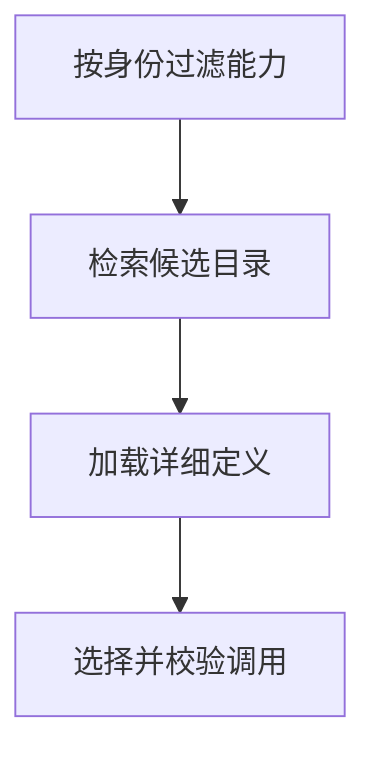

import InterviewQuestion from '../../../../components/InterviewQuestion.astro';

<InterviewQuestion>

大规模能力集通常分层加载：先提供简短能力目录，再按任务检索候选，最后加载具体说明和工具 Schema。权限过滤在选择前完成；召回不足时允许补充搜索，但要限制次数。

## 检索能力不等于获得权限

能力注册表保存标识、描述、版本、参数和授权范围。语义检索可与领域标签或规则结合，候选交给模型决策后仍做授权和业务校验。记录目标工具是否在候选中、是否被正确选择、参数和执行是否成功。

### 检索没召回正确工具时怎样兜底？

可以扩大候选、按类别检索或向用户澄清意图；不能让模型编造接口。对经常混淆的能力调整描述和层级，并用包含无工具可用的测试集检查拒绝能力。

资料

核对于 2026-10-14。[Agent Skills 规范](https://agentskills.io/specification)、[Spring AI 工具调用](https://docs.spring.io/spring-ai/reference/api/tools.html)。正文场景、示例代码与方案取舍为教学示例；具体接口按选定版本核对。

</InterviewQuestion>
