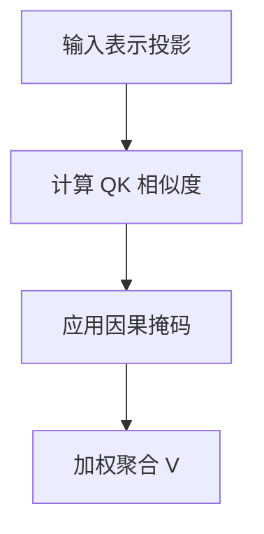

import InterviewQuestion from '../../../../components/InterviewQuestion.astro';

<InterviewQuestion>

输入表示分别线性投影得到 Q、K、V，注意力权重由 Q 与 K 的相似度计算，再对 V 加权聚合。缩放点积形式为 softmax(QKᵀ / √dₖ + mask)V；因果掩码阻止当前位置访问未来 Token。

## 解释形状与计算量

单头序列长度 n、头维度 dₖ，注意力分数矩阵为 n×n。多头关注不同投影子空间，拼接后再投影。全注意力的分数部分随序列长度平方增长，但整层还包含投影和前馈网络，不能只按 n²估算全部耗时。

### Next Token Prediction 为什么必须屏蔽未来？

训练输入包含目标后续文本，若允许看到未来 Token 会泄漏答案。推理逐步生成，历史 K、V 可缓存；KV 容量与推理优化见 AI Infra 对应题。

资料

核对于 2026-10-14。[Attention Is All You Need](https://arxiv.org/abs/1706.03762)。正文场景、示例代码与方案取舍为教学示例；具体接口按选定版本核对。

</InterviewQuestion>
