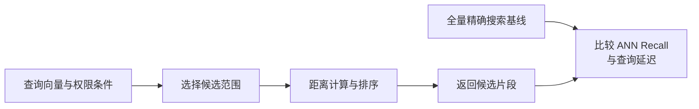

import InterviewQuestion from '../../../../components/InterviewQuestion.astro';

<InterviewQuestion>

逐条算余弦是全量精确比较，朴素计算量随向量条数和维度增长。Milvus 等向量数据库还管理索引、元数据过滤、持久存储和数据更新。数据库可以用精确搜索，也可以用近似最近邻索引减少搜索范围；“用了向量库”不等于检索一定更准。

| 方式 | 如何减少工作量 | 主要取舍 |
| --- | --- | --- |
| Flat | 扫描全部向量 | 结果可作精确基线，数据大时更慢 |
| HNSW | 沿多层邻接图搜索 | 内存与构建成本；扩大搜索范围可提高召回 |
| IVF | 先定位聚类桶，再查部分桶 | 桶数、探测桶数与数据分布影响速度和召回 |

## 先分清两种召回

ANN Recall 衡量近似索引是否找回精确搜索的邻居；业务 Recall 衡量是否找回正确证据。前者很高，后者仍可能很差，因为 Embedding 或分块不适合业务。

选型先固定数据、过滤条件、并发和延迟目标，再调搜索参数，记录内存与建库时间。权限过滤必须进入服务端检索链；过滤在搜索中的具体执行策略取决于版本和索引实现，应在真实条件下测试。

### 小数据也一定要向量数据库吗？

不一定。少量、变化少的向量可以用简单精确搜索。需要持续更新、多人查询、过滤或更大容量时，再引入数据库；不要用产品名字替代容量估算。

资料

核对于 2026-10-15。[Milvus 索引机制](https://milvus.io/docs/index-explained.md)、[距离度量](https://milvus.io/docs/metric.md)。基线与选型方法为本站工程建议。

</InterviewQuestion>
