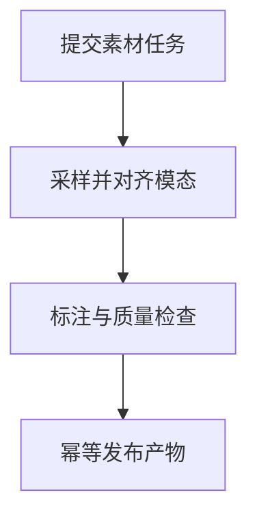

import InterviewQuestion from '../../../../components/InterviewQuestion.astro';

<InterviewQuestion>

视频任务先处理采样帧、音频、字幕和时间对齐，再按标签定义标注并合并结果。媒体处理耗时长，应采用异步任务、可查询进度和幂等回调；上传完成不等于标注完成。

## 产物必须能定位到原始素材

保留时间戳、片段范围、素材版本及模型版本，选择采样策略时评测短事件漏检。任务按解码、识别、标注与审核分阶段恢复，回调携带事件标识，重复到达不会重复发布。

### 只抽几帧能保证理解完整视频吗？

不能，短暂事件、音频含义和跨镜头关系可能丢失。按业务目标选择密度和模态，对漏检与时延做取舍，最终结果明确覆盖范围。

资料

核对于 2026-10-14。[Spring AI 工具调用](https://docs.spring.io/spring-ai/reference/api/tools.html)。正文场景、示例代码与方案取舍为教学示例；具体接口按选定版本核对。

</InterviewQuestion>
