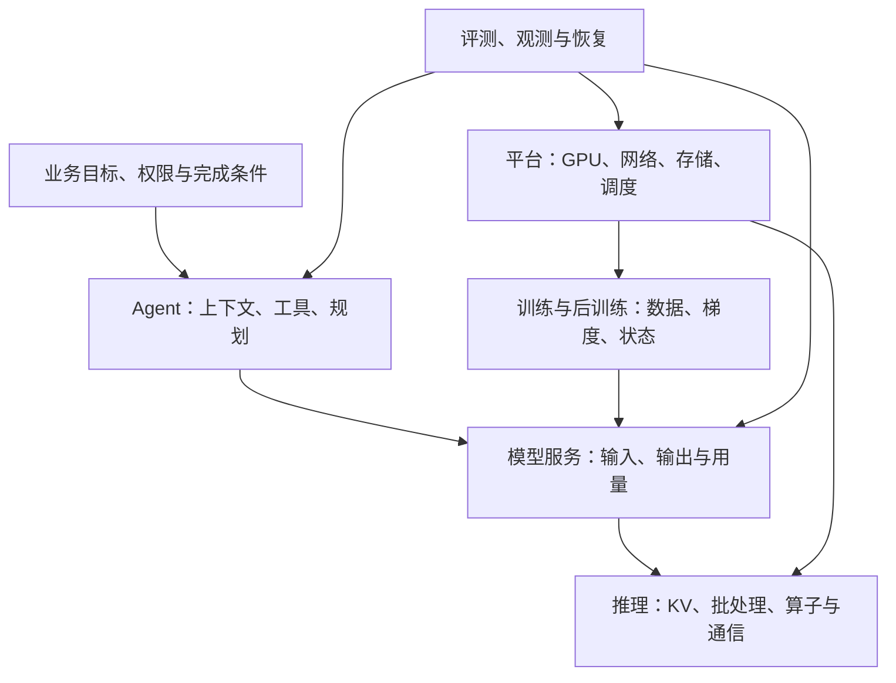

Agent 开发关注怎样把模型接进真实任务：准备信息、调用工具、控制执行、检查结果。AI Infra 关注这些模型怎样训练和运行：显存、算子、通信、调度与服务性能。两个方向都需要理解对方的边界，例如 Agent 的长上下文会直接影响推理服务的 KV 和时延。

当前有 56 题：Agent 开发 38 题，AI Infra 18 题。[进入 AI 工程问答](/interview/)。Agent 根据国内公司公开面经补充并按样本出题频次排序；原帖、转述与去重口径见[面经来源](/interview/agent-sources/)。难度是本站的学习顺序，不代表厂商招聘标准；AI Infra 按机制学习顺序排列。

## Agent 开发怎么读

| 层次 | 当前覆盖 | 阅读入口 |
| --- | --- | --- |
| 基础 | Workflow 与 Agent、工具调用、Token 与采样、提示词、RAG 建库、MCP、Skills、项目证据 | [基础题](/interview/?track=agent&level=basic) |
| 进阶 | RAG 排障、混合检索、框架与状态、Harness、模型与 Embedding 选型、文件搜索、多模态解析、AI Coding | [进阶题](/interview/?track=agent&level=intermediate) |
| 困难 | 评测集、答案检测、延迟排障、上下文压缩、记忆更新、向量索引、知识图谱、会话隔离、热插拔、恢复与安全 | [困难题](/interview/?track=agent&level=advanced) |

先读基础题，再看相应机制失败时怎么办。排障时沿执行链检查：任务是否明确、输入证据是否正确、工具是否适用、执行是否符合权限、结果是否经过验证。

## AI Infra 怎么读

| 层次 | 当前覆盖 | 阅读入口 |
| --- | --- | --- |
| 基础 | 训练与推理、GPU 瓶颈、Prefill/Decode、KV 容量、精度与量化、集合通信 | [6 道基础题](/interview/?track=infra&level=basic) |
| 进阶 | 批处理、PagedAttention、前缀缓存、投机解码、服务指标与压测、重计算与梯度累积 | [6 道进阶题](/interview/?track=infra&level=intermediate) |
| 困难 | DP/TP/PP/ZeRO、容量与 OOM、PD 分离、MoE 专家并行、后训练流水线、GPU 调度 | [6 道困难题](/interview/?track=infra&level=advanced) |

容量问题先算权重与运行状态，性能问题先量计算、数据移动和等待。比较方案时给定模型、精度、硬件、输入输出长度、并发和延迟目标，不能直接对比来自不同条件的加速数字。数据加载、训练容错和底层 kernel 还有更细的专题，当前题目覆盖主干机制。

## 国内公开资料入口

| 来源 | 适合核对什么 |
| --- | --- |
| [阿里云百炼](https://help.aliyun.com/zh/model-studio/rag-knowledge-retrieval) | 检索、重排与模型接口；[结构化输出](https://help.aliyun.com/zh/model-studio/qwen-structured-output) |
| [阿里 AgentScope](https://doc.agentscope.io/tutorial/index.html) | 工具、MCP、记忆、计划、状态、评测与 Trace |
| [Qwen-Agent](https://github.com/QwenLM/Qwen-Agent) | 工具调用、流式处理、MCP 与 RAG 的开源示例 |
| [Spring AI Alibaba](https://github.com/spring-ai-alibaba/website/blob/main/docs/frameworks/agent-framework/tutorials/hooks.md) | Java Agent 的人工确认、调用限制与工具重试 |
| [阿里云 Agent Handbook](https://github.com/aliyun/ai-agent-handbook) | 生产运行、可观测性、网关与安全 |
| [阿里云 PAI](https://help.aliyun.com/zh/pai/product-overview/service-architecture) | 计算、训练与服务边界；[InferX](https://help.aliyun.com/zh/pai/create-and-manage-inference-services)、[调度策略](https://help.aliyun.com/zh/pai/scheduling-policies) |
| [Pai-Megatron-Patch](https://github.com/alibaba/Pai-Megatron-Patch) | 训练并行、状态分片、模型与配置；[训练参数](https://help.aliyun.com/zh/pai/parameter-settings) |
| [阿里 DashInfer](https://github.com/modelscope/dash-infer) | KV 分页、前缀缓存、量化和约束解码 |
| [腾讯云 TI-ONE](https://cloud.tencent.com/document/product/851/132711) | 推理性能评测的并发、容量与时延约束 |
| [字节发起的 verl](https://verl.readthedocs.io/en/latest/hybrid_flow.html) | 后训练数据流；[异步训练](https://verl.readthedocs.io/en/latest/advance/v1_async_trainer.html) |
| [Kimi Mooncake](https://arxiv.org/html/2407.00079v1) | KV 传输、缓存调度与 PD 分离；[官方代码](https://github.com/kvcache-ai/Mooncake) |
| [DeepSeek-V3 技术报告](https://arxiv.org/html/2412.19437v2) | MoE 通信、专家放置、MTP 与训练系统 |

每题的“资料”折叠区保留对应链接和核对日期。国内平台资料用来核对产品实践，必要的原理再补原始论文及框架官方文档；正文中的算例、场景和选型建议明确与厂商实测区分。涉及部署时，参数及支持范围仍以选定版本为准。
