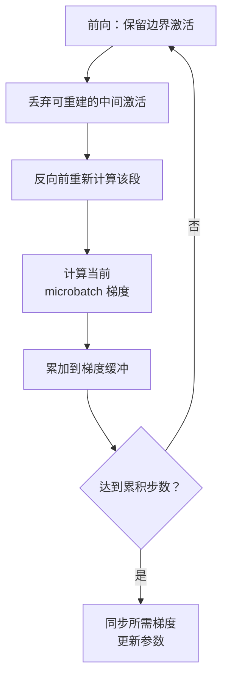

import InterviewQuestion from '../../../../components/InterviewQuestion.astro';

<InterviewQuestion>

激活重计算只保存部分前向中间结果，反向时把缺失的部分重新算出来，用更多计算换显存。梯度累积把一次参数更新需要的样本拆成多个 microbatch，分次前向和反向，累加梯度后再更新。

梯度累积能减少一次处理的样本数及相应激活，但权重、优化器状态和累积梯度仍要保存。已经是参数或优化器状态占满显存时，光减 microbatch 未必有用。

## 大 batch 被拆开，更新节奏要保持一致

在固定数据并行度、每卡 microbatch 和累积步数的常规设置下，全局 batch 等于三者乘积。例如数据并行度 4、每卡 2 条、累积 8 次，每次更新处理 64 条样本；TP 和 PP 的卡数不能再重复乘进去。

损失归一化、学习率调度、梯度同步和清零时机要匹配。变长样本还要确认按样本还是按有效 Token 归一化，不能假设拆开后结果一定逐 bit 相同。

### Activation checkpointing 是故障恢复吗？

不是。它在一次训练迭代内控制激活保存。训练恢复 Checkpoint 则要保存权重、优化器、训练步数、调度器及必要的随机数和数据进度，供进程退出后继续训练。

### 重计算什么时候不划算？

显存已经足够、计算是瓶颈时，重计算可能只拖慢速度。含随机或有副作用的计算还要保证重跑语义正确。先量激活峰值和迭代时间，再决定重算哪些层。

资料

核对于 2026-10-13。[阿里云训练参数中的激活检查点与梯度累积](https://help.aliyun.com/zh/pai/parameter-settings)、[verl 训练状态保存](https://verl.readthedocs.io/en/latest/workers/model_engine.html)。64 条样本为教学算例，具体参数支持范围以框架版本为准。

</InterviewQuestion>
