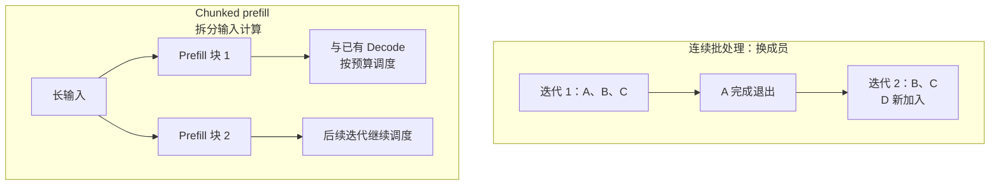

import InterviewQuestion from '../../../../components/InterviewQuestion.astro';

<InterviewQuestion>

连续批处理在生成迭代之间调整成员：完成的请求退出，有资源时让新请求加入，不必等整批最长的请求结束。

Chunked prefill 则把长输入拆成较小的计算块，方便与正在 Decode 的请求一起调度。一个改变谁在这批里，另一个改变长输入每轮做多少工作。

## 为什么批量不能一直加大

更大批量可能提高总吞吐，也可能增加排队和逐字延迟。调度同时受活跃序列数、每轮 token 预算和 KV 容量限制。

vLLM V1 当前文档中的 Chunked prefill 策略先安排 Decode，再用剩余 token 预算处理 Prefill。`max_num_batched_tokens` 控制每轮 token 工作量，`max_num_seqs` 控制序列数，不能互相当成同一个参数。

调参时固定模型和输入输出分布，一次改一个参数，同时看 TTFT、输出间隔、吞吐、排队和抢占。默认值与支持条件按部署版本核对。

### PagedAttention 就是连续批处理吗？

不是。PagedAttention 管缓存怎样存，连续批处理管请求怎样参加生成迭代。两者能配合，解决的不是同一个问题。

### 只看最大 token/s 有什么问题？

可能选出吞吐高、用户却等得更久的配置。先确定延迟和成功率要求，再比较达标的吞吐。

资料

核对于 2026-10-13。依据：[Orca](https://www.usenix.org/conference/osdi22/presentation/yu)、[vLLM 优化文档](https://docs.vllm.ai/en/latest/configuration/optimization/)、[阿里云压测](https://help.aliyun.com/zh/pai/automatic-service-stress-testing)。请求长度与调参步骤为教学示例。延伸阅读：[批处理与调度实验](/ai-infra/batching-scheduling/)。

</InterviewQuestion>
