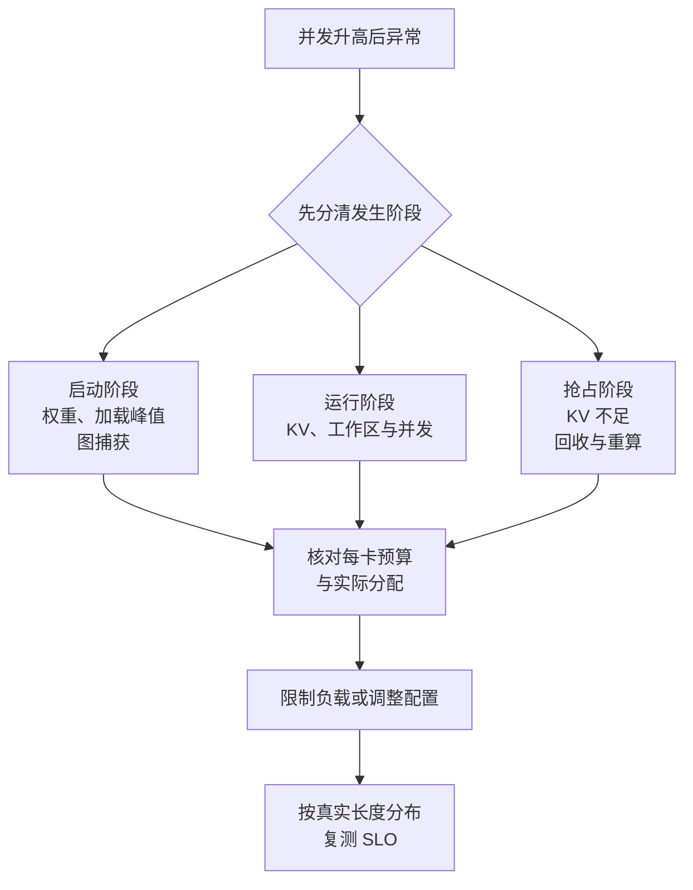

import InterviewQuestion from '../../../../components/InterviewQuestion.astro';

<InterviewQuestion>

能启动、能跑单请求，不代表并发后还放得下。运行时还会增加 KV、激活、算子工作区、图捕获和通信缓冲。

先分清三件事：加载或启动时 OOM、运行时 OOM、KV 不足导致的抢占重算。抢占不等于进程 OOM，但重算会让请求更慢。提高 gpu_memory_utilization 不是通用解法，还可能挤掉其他运行开销的余量。



## 给输出增长留空间

假设扣除权重、运行开销和余量后，KV 有 8 GiB 预算；模型每 token KV 为 128 KiB。每条请求输入 4096 token，再为 1024 个新增缓存位置留空间，按 5120 token 估算：

```text
单请求 = 5120 × 128 KiB = 640 MiB
理论驻留上界 = floor(8192 / 640) = 12 条
```

只算输入会估成 16 条，生成增长后就可能不够。这仍是内存上界，不是“12 个并发一定满足延迟”的承诺，还要算分页空位、分片和调度差异，再用真实长度分布压测。

先限制超长请求、活跃序列和每轮 token 工作量，再评估量化、缓存精度、TP 或扩容。每卡显存、排队、缓存占用、抢占和延迟要一起看。

### 降低 max_num_seqs 一定能解决吗？

不一定。单条超长输入、加载峰值或工作区过大，也会 OOM。减并发还可能让排队更长，所以改完仍要测 TTFT。

### 把 KV 放到分布式缓存，就不缺显存了吗？

不是。它扩大存储和复用范围，执行时仍需把必要 KV 放到可计算的位置。搬运有开销；TP 也会增加通信。先确定瓶颈，再比较代价。

<details data-reader-ignore>
<summary>资料</summary>

核对于 2026-10-15。依据：[vLLM 优化](https://docs.vllm.ai/en/latest/configuration/optimization/)、[PAI 监控](https://help.aliyun.com/zh/pai/service-monitoring)、[PAI 缓存服务](https://help.aliyun.com/zh/pai/inferx-kv-cache)。容量为教学算例。延伸阅读：[KV cache 容量推导](/ai-infra/kv-cache/)。

</details>

</InterviewQuestion>
