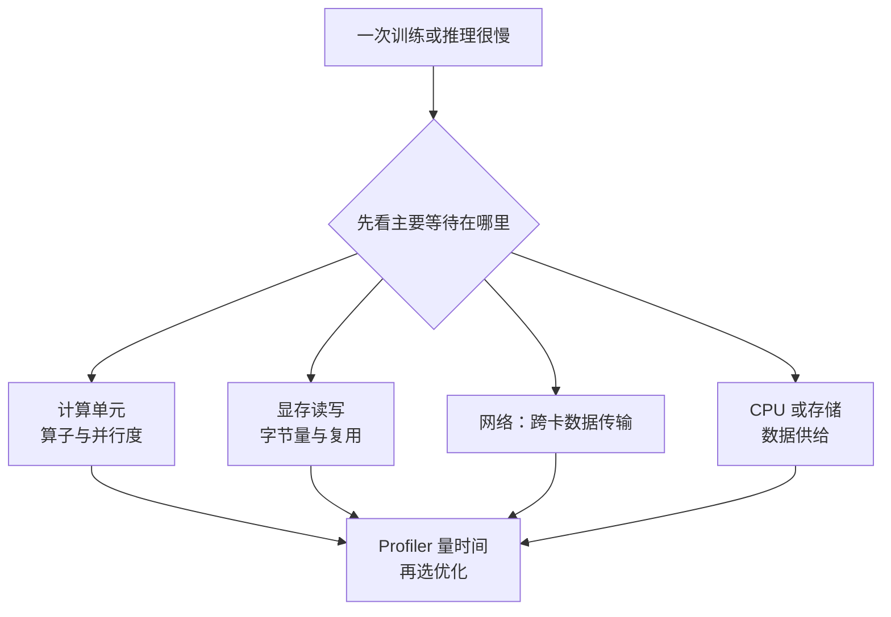

import InterviewQuestion from '../../../../components/InterviewQuestion.astro';

<InterviewQuestion>

算力限制单位时间能完成多少计算；显存容量限制权重和运行状态能否放下；显存带宽限制数据能多快送到计算单元。模型放得下、GPU 很忙，仍可能因为数据移动慢而跑不快。

算术强度是完成的运算量除以读取和写入的字节数。搬一次数据后能做很多计算，更容易受算力限制；频繁搬数据却只算一点，更容易受带宽限制。Roofline 用这两种上限估计性能，但实际还会受并行度、通信和启动开销影响。

## 利用率只是起点

常见 GPU utilization 表示采样时间内 GPU 是否有工作，不等于达到峰值算力，也不能说明 Tensor Core 是否充分使用。还要看算子时间、显存吞吐、通信、CPU 和数据加载。

小 batch 的 Decode 经常需要读取大量权重，计算复用较少；扩大 batch 可能提高复用，但会增加排队和 KV 占用。Prefill 也会随序列长度、batch 和算子实现改变瓶颈，不能只凭阶段名称下结论。

### 算子融合为什么可能加速？

多个操作合成一个 kernel，可以减少启动次数和中间数据写回显存。收益取决于数据复用、寄存器占用和实现质量，不是把所有算子合在一起就一定快。

### 换更高 TFLOPS 的卡，一定有用吗？

若主要时间花在数据加载或网络等待，更多算力未必能解决问题。先量出瓶颈；比较硬件时还要统一精度、模型、负载和延迟目标。

资料

核对于 2026-10-15。[阿里云 PAI 资源与系统架构](https://help.aliyun.com/zh/pai/product-overview/service-architecture)、[NVIDIA GPU Performance Background](https://docs.nvidia.com/deeplearning/performance/dl-performance-gpu-background/index.html)。排障顺序为工程建议。

</InterviewQuestion>
