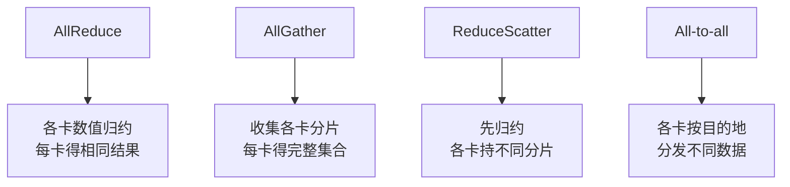

import InterviewQuestion from '../../../../components/InterviewQuestion.astro';

<InterviewQuestion>

AllReduce 把各卡的数据归约，例如求和，再让每卡拿到结果；AllGather 把各卡不同的分片收集起来，让每卡拿到完整集合；All-to-all 则让每卡向其他卡发送不同部分，适合按目标专家分发 Token。

数据并行常用 AllReduce 同步梯度，状态分片会用到 AllGather 和 ReduceScatter，MoE 专家并行会做分发与合并。通信操作由算法需要决定，不能互相随意替换。

## 多一张卡，也多了通信和等待

模型计算分到更多卡后，每卡计算可能变少，但通信频率、传输量或同步等待未必同比下降。小消息容易受延迟限制，大消息更依赖带宽；某个 rank 慢了，其他 rank 可能在集合通信里等待。

机内 NVLink、PCIe 与跨机网络的拓扑和能力不同。RDMA 减少主机数据搬运和 CPU 参与，具体 GPU 直通路径还要看硬件、驱动与配置。使用 RDMA 不等于网络一定没有瓶颈。

### 通信和计算重叠，等于通信免费吗？

只有数据依赖和执行资源允许时，才能把传输藏在计算期间。通信也可能占用 GPU 或网络资源；当传输比可重叠计算更长，仍会暴露等待时间。

### 训练卡在 NCCL，先查什么？

确认所有 rank 是否还活着，是否按相同顺序参与通信。某卡 OOM、数据加载异常或走了不同分支，可能让其他卡看起来像网络挂住。再查拓扑、链路和通信日志，别只改超时。

资料

核对于 2026-10-13。[NCCL 集合通信语义](https://docs.nvidia.com/deeplearning/nccl/user-guide/docs/usage/collectives.html)、[DeepSeek-V3 通信与并行设计](https://arxiv.org/html/2412.19437v2)、[阿里云 PAI 架构](https://help.aliyun.com/zh/pai/product-overview/service-architecture)。排障顺序为工程建议。

</InterviewQuestion>
