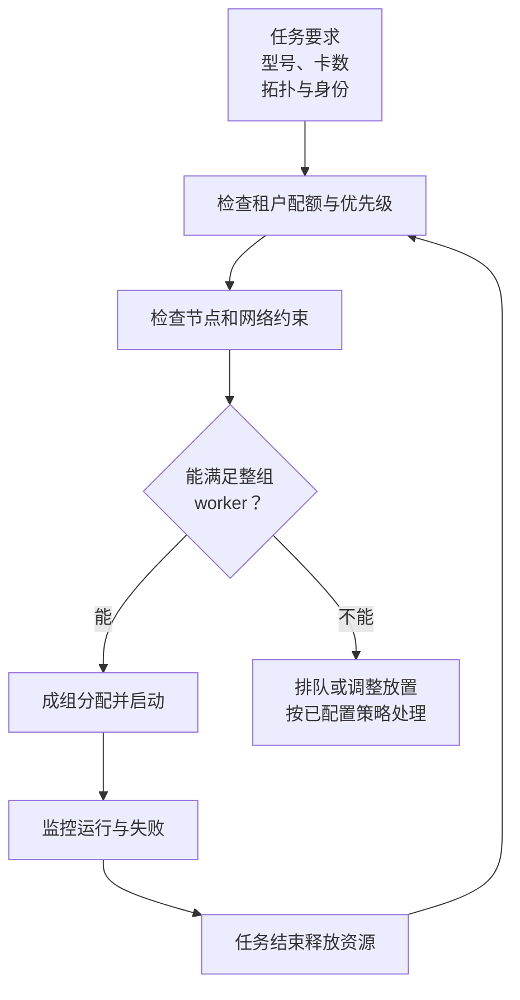

import InterviewQuestion from '../../../../components/InterviewQuestion.astro';

<InterviewQuestion>

空闲卡数只是一个总数。任务可能要求相同型号、足够显存、同机互联、跨机网络和同时启动的 worker；散在多个节点的空闲卡，不一定能满足这些条件。

例如需要同机 4 卡的任务，遇到四台机器各空 1 卡，仍无法放置。数据集挂载、镜像准备、配额和资源预留也可能阻止启动，不能把排队都归因于卡不够。

## 吞吐和公平可能冲突

FIFO 容易被队首的大任务挡住；跳过放不下的任务，可以先跑小任务，但大任务可能长期得不到机会。要结合配额、优先级、等待时间和保留资源处理，不能只追求空闲率最低。

成组调度避免只启动一部分 worker 却长期等其余成员，但它不保证模型不会 OOM 或网络没有故障。任务占了多少卡、实际使用多少资源、排队多久，应分开观察。

### 在线推理扩容，也按 GPU 利用率触发吗？

还应看请求排队、等待 Token、TTFT、输出速度和 KV 压力。新实例有下载权重、加载和预热时间；等延迟已经失控再扩容，可能来不及。缩容要先停止接收新请求，再处理已有生成和缓存。

### 高优先级任务能直接抢占低优先级任务吗？

排队优先级与抢占是不同策略。抢占会丢失未保存的进度，还要等待资源释放。训练需要可恢复 Checkpoint，在线服务要处理在途请求，是否允许抢占应明确配置。

资料

核对于 2026-10-15。[阿里云 PAI 调度策略](https://help.aliyun.com/zh/pai/scheduling-policies)、[PAI 调度配置与配额](https://www.alibabacloud.com/help/zh/pai/scheduling-configuration)、[InferX 实例扩缩容](https://help.aliyun.com/zh/pai/create-and-manage-inference-services)。同机 4 卡、成组调度与扩容判断为机制示例。

</InterviewQuestion>
