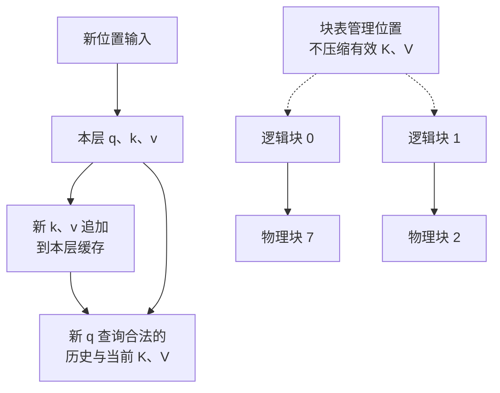

import InterviewQuestion from '../../../../components/InterviewQuestion.astro';

<InterviewQuestion>

KV cache 保存每层已经处理的位置对应的 Key 和 Value。生成新 token 时，用新 Query 查询历史 K、V，不必重算旧位置。缓存的不是聊天文本，也不是模型权重。

各层结构相同、采用全注意力、无压缩和共享时，单请求容量是：`2 × 层数 × KV heads × 每头维度 × token 数 × 每元素字节数`。不同长度请求按各自 token 数累加。



## 算一次显存

设 32 层、8 个 KV heads、每头 128 维，KV 用 FP16，每元素 2 字节。

```text
每 token = 2 × 32 × 8 × 128 × 2 = 128 KiB
4096 token = 512 MiB
8 个同长请求 = 4 GiB
```

要用 KV heads，不能用 Query heads。GQA 的 KV heads 更少，所以缓存更小；这属于模型结构，不能随便改服务参数就得到等价模型。

PagedAttention 把缓存切成块，通过块表映射到物理位置，减少按最大长度预留连续空间的浪费。有效 K、V 仍要占空间。

假设每块 16 token，4100 token 要 257 块，共 4112 个槽位，分配 514 MiB，尾部 12 个空位占 1.5 MiB。这些都还没算引擎预留的整个缓存池。

### 为什么不保留旧 Query？

新位置做 Attention，需要新 Query 与历史 K、V，旧 Query 不必再作为这次计算的输入。每层输入不同，缓存也要分层保存。

### Prefix cache 和回答缓存一样吗？

不一样。前者复用模型算出的 KV，后者复用最终回答。复用 KV 要满足模型、前缀和计算条件兼容。滑动窗口、MLA、混合结构、量化和多卡分片，应按实际结构重算容量。

<details data-reader-ignore>
<summary>资料</summary>

核对于 2026-10-13。依据：[Transformers cache](https://huggingface.co/docs/transformers/cache_explanation)、[PagedAttention](https://arxiv.org/abs/2309.06180)、[PAI KV Cache](https://help.aliyun.com/zh/pai/inferx-kv-cache)。容量为指定假设下的算例，不是硬件实测。延伸阅读：[KV cache 完整推导与实验](/ai-infra/kv-cache/)。

</details>

</InterviewQuestion>
