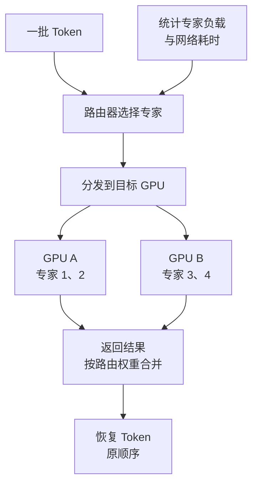

import InterviewQuestion from '../../../../components/InterviewQuestion.astro';

<InterviewQuestion>

MoE 的路由器为每个 Token 选择少量专家参与计算，所以激活参数少于总参数。但所有专家的权重仍要存放，跨卡分布时还要把 Token 送到目标专家，再把结果送回来。

专家并行 EP 把不同专家放到不同 GPU；TP 切分同一层或专家内部的张量。两者可以组合，但增加并行维度也会增加通信与调度复杂度。

## 最忙的专家可能拖慢整个批次

Token 分布不均，会让一张卡排队，另一张卡空闲。平均 GPU 利用率掩盖了这种偏斜。看每个专家的 Token 数、计算时间、分发与合并通信，才能判断是热点还是网络问题。

训练可采用负载均衡策略；服务侧可按实测负载调整放置、批处理或复制热点专家。复制会增加权重占用，跨节点迁移也有代价。是否允许丢弃或改路由 Token，要服从模型算法，不能为了吞吐随意改输出语义。

### 总参数和激活参数该分别用在哪里？

总参数影响权重存储与加载预算；激活参数帮助估计一部分计算量。部署显存还包括 KV、工作区、重复专家和通信缓冲，不能只按“每 Token 激活多少 B”选卡。

### EP 越大，单请求越快吗？

不一定。每个专家拿到的 batch 变小，计算效率可能降低，分发与合并却仍有成本。并行度、专家布局和负载要一起压测；论文中某个大集群配置不能直接套到小服务。

资料

核对于 2026-10-13。[DeepSeek-V3 专家通信与部署设计](https://arxiv.org/html/2412.19437v2)、[阿里云 Pai-Megatron-Patch](https://github.com/alibaba/Pai-Megatron-Patch)。双 GPU 专家布局为示意，热点复制的收益需要实测。

</InterviewQuestion>
