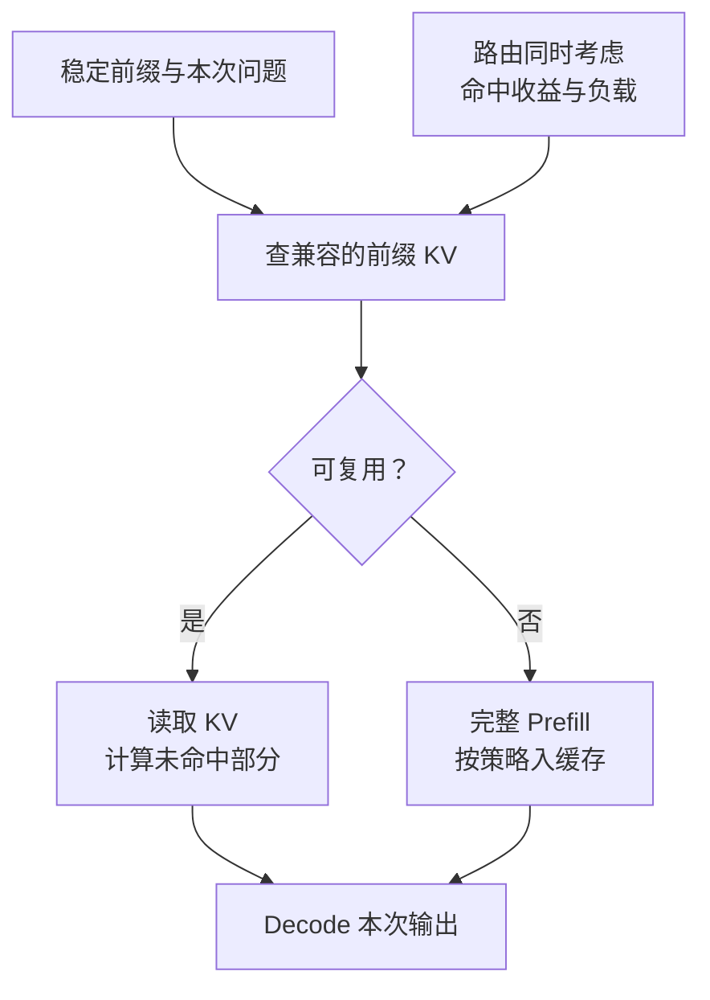

import InterviewQuestion from '../../../../components/InterviewQuestion.astro';

<InterviewQuestion>

Prefix cache 复用相同输入前缀已经算出的 KV，让后续请求少做一部分 Prefill。它缓存的是中间计算状态，不是整段答案；问题不同，仍要计算剩余输入并生成输出。

例如一组请求共用同一份长系统规则，把稳定内容放前面，变量放后面，更容易命中前缀。通常要求前缀 Token 一致，还要保证模型、适配器和相关执行配置兼容；文字意思相近不够。

## 命中收益要减去搬运和排队

KV 在本地 GPU，复用成本与保存在 CPU 或远端存储不同。远端命中还要花传输时间。缓存节点已经过载时，为了命中把所有请求挤过去，可能让尾延迟更差。

评估时看复用的 Token 数、节省的 Prefill 时间、读取代价和 TTFT，不能只看“请求命中率”。长前缀很少重复时，维护缓存可能得不偿失。

### 和完整答案缓存有什么区别？

答案缓存直接复用过去的业务输出，需要判断问题、资料时效和身份权限是否一致。前缀 KV 只省前缀计算，并不承诺新答案相同，也不替代业务数据更新。

### 多租户可以共用吗？

不能默认按文本相同就共享。缓存命名空间应包含需要隔离的身份和模型配置，权限撤销、模型切换时也要处理失效。是否可跨租户复用，要按数据范围和系统能力明确设计。

资料

核对于 2026-10-15。[阿里云 InferX KV Cache 服务](https://help.aliyun.com/zh/pai/inferx-kv-cache)、[DashInfer Prefix Cache](https://github.com/modelscope/dash-infer)、[Kimi Mooncake 论文](https://arxiv.org/html/2407.00079v1)。路由及租户隔离为工程设计建议。

</InterviewQuestion>
