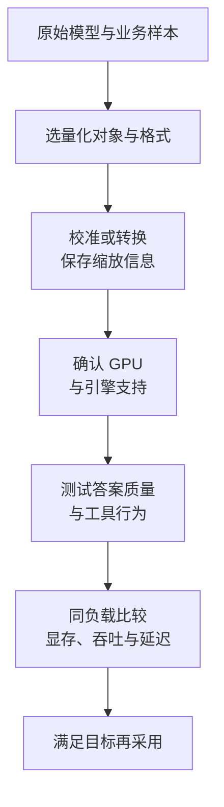

import InterviewQuestion from '../../../../components/InterviewQuestion.astro';

<InterviewQuestion>

FP16 和 BF16 都占 16 bit，但表示范围与精度分配不同：BF16 的指数范围更大，尾数精度较低。INT8、INT4 量化用更少 bit 表示数值，通常还要保存缩放系数等信息，以较小存储换取数值误差。

先说清量化的是权重、激活还是 KV。W4A16 表示权重用 4 bit、激活用 16 bit；权重变小，不会自动把全部运行状态也缩成四分之一。

## 省显存和加速是两件事

权重压缩可以减少存储和搬运，但解量化、低效 kernel 或不支持的硬件会抵消收益。低并发与高并发的瓶颈也不同。不要只看模型文件大小，实际服务还要算 KV、工作区和其他内存。

AWQ 利用激活信息保护重要权重通道；GPTQ 用近似二阶信息减少权重量化误差。两者的效果与校准数据、模型及实现有关，不能只按名字判断哪个更好。

### 7B 模型的 INT4 权重需要多少内存？

只算 70 亿个参数，每个 0.5 字节，约 3.5 GB，按十进制计算。还没计缩放系数、未量化层和运行状态，所以不能据此承诺一张 4 GB 卡能部署。

### 量化验证只看通用榜单够吗？

还要测试实际业务的长上下文、检索回答、JSON 和工具调用。轻微数值误差可能改变输出路径。FP8 也有多种格式与实现，不能把它简单当成 INT8 的另一个名字。

资料

核对于 2026-10-13。[Qwen 量化模型评测](https://qwen.readthedocs.io/en/v2.0/benchmark/quantization_benchmark.html)、[阿里 DashInfer 量化支持](https://github.com/modelscope/dash-infer)、[AWQ 论文](https://arxiv.org/abs/2306.00978)、[GPTQ 论文](https://arxiv.org/abs/2210.17323)。7B 数字仅为权重容量算例。

</InterviewQuestion>
