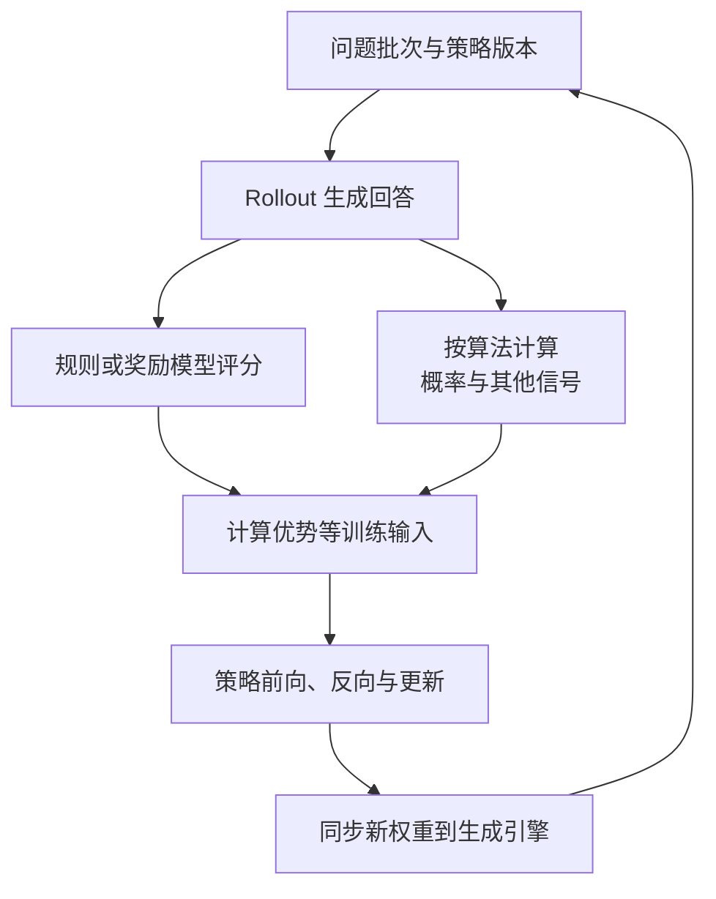

import InterviewQuestion from '../../../../components/InterviewQuestion.astro';

<InterviewQuestion>

这类后训练要让当前策略生成回答，也就是 Rollout，再评分、计算训练信号并更新参数。生成和训练的资源需求不同，还要同步新权重，因此不能只用普通 SFT 的吞吐估算总耗时。

PPO 常包含策略、参考、奖励和价值计算等组件；GRPO 用同一问题的一组回答计算相对训练信号，通常不需要独立的价值模型。奖励也可以是程序规则，不一定是另一个大模型。

## 同卡切换和分离部署各有代价

同卡部署可在不同阶段复用 GPU，减少长期闲置，但需要安排权重、KV、优化器状态的加载或卸载，切换耗时和峰值显存都要计入。分离资源池方便各自扩容、并行流水，但要付权重同步和数据传输成本。

看完整训练轮次的时间分解：生成、评分、更新、同步和等待。生成长度差异很大时，少数长样本可能拖住整个批次；应结合算法要求做长度与资源调度。

### 为什么必须记录策略版本？

样本是哪个版本生成的，会影响训练所需概率和数据新鲜度。训练引擎更新后，Rollout 引擎可能还持有旧权重。同步应有版本和完成边界，避免半数 worker 用新权重、半数用旧权重而系统不知道。

### 异步生成一定更好吗？

异步可以减少等待，但引入旧策略数据、队列积压和恢复难度。是否能使用这些样本取决于算法及实现，不能只追求每张卡忙碌。比较有效训练产出、收敛与总资源成本。

资料

核对于 2026-10-13。[字节 verl HybridFlow 数据流](https://verl.readthedocs.io/en/latest/hybrid_flow.html)、[verl 性能调优](https://verl.readthedocs.io/en/latest/perf/perf_tuning.html)、[verl 异步训练模式](https://verl.readthedocs.io/en/latest/advance/v1_async_trainer.html)。图省略算法特有分支，不表示 PPO 与 GRPO 的组件完全相同。

</InterviewQuestion>
