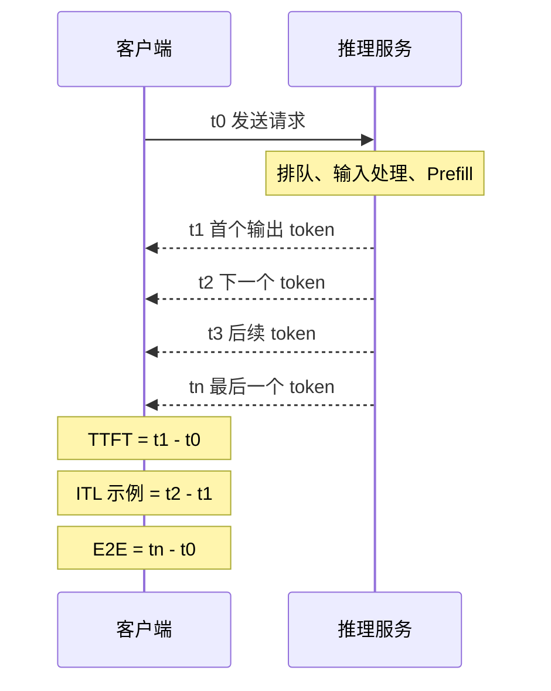

import InterviewQuestion from '../../../../components/InterviewQuestion.astro';

<InterviewQuestion>

TTFT 是发送请求到收到首个输出 token 的时间。ITL 是相邻输出 token 的间隔。TPOT 通常指首个 token 之后的平均每 token 时间。端到端延迟则从请求发出算到最后一个输出，受到输出长度影响。

总 token/s 表示系统单位时间完成多少工作，不代表单个用户生成得快。批量加大后，总吞吐可能上升，排队和逐字等待也可能一起上升。

逐 token 到达、输出数大于 1 时，可以用 `TPOT = (最后到达时间 - 首个到达时间)/(输出 token 数 - 1)`。一次包可能包含多个 token；不同平台也可能把 TPOT 用来表示逐包间隔。比较之前先对齐测量位置、token 计数和分包方式。

## 压测时固定哪些条件

固定模型版本、精度、硬件、输入输出长度分布、请求到达节奏和缓存条件。冷热缓存、重复 Prompt 分开报告；输入和输出 token/s 也分开报告。

固定并发的闭环压测会在服务变慢时自动降低发送速度，可能看不出持续到达的流量造成多少积压。按固定到达率发送请求，更容易观察排队，但要设置超时、拒绝和停止条件。

### P99 可以从平均值推出来吗？

不能。P99 是 99 百分位，平均值无法反映长尾。各实例的 P99 也不能直接平均成全局 P99，应从一致口径的样本或可合并分布中计算。

### 什么叫有效吞吐？

先定义成功条件，例如内容完整、没有超时，TTFT 和输出间隔都达标，再统计这些请求每秒完成多少，或生成多少 token。只报吞吐而不报成功率和延迟约束，容易掩盖过载。

资料

核对于 2026-10-13。依据：[阿里云 EAS 压测](https://help.aliyun.com/zh/pai/automatic-service-stress-testing)、[腾讯云 TI-ONE](https://cloud.tencent.com/document/product/851/132711)、[vLLM Production Metrics](https://docs.vllm.ai/en/latest/usage/metrics/)。公式与压测取舍为统一口径的教学解释；不同平台字段定义需核对。延伸阅读：[性能分析与实验](/ai-infra/performance-analysis/)。

</InterviewQuestion>
