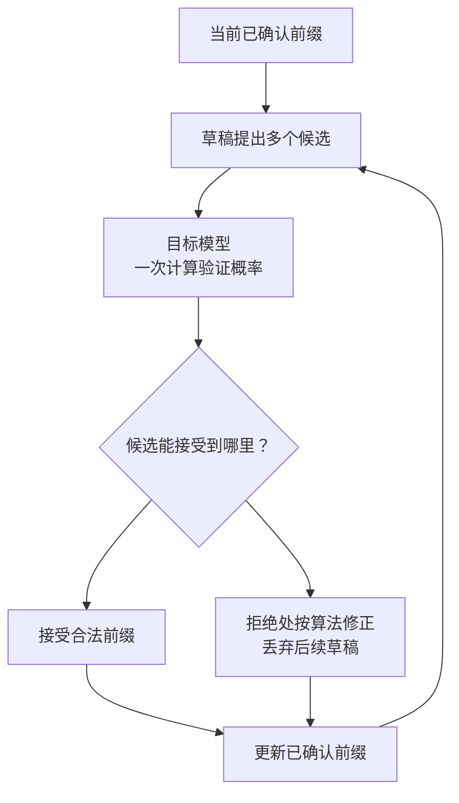

import InterviewQuestion from '../../../../components/InterviewQuestion.astro';

<InterviewQuestion>

投机解码先用便宜的方法提出多个候选 Token，再让目标模型一次验证。接受的前缀可以一起输出；遇到拒绝点，按算法修正，再继续下一轮。它减少目标模型串行生成的轮数，不是跳过目标模型检查。

草稿可以来自小模型、辅助预测头或其他方法。目标模型已拿到候选序列，因此能并行计算这些位置的条件概率；单独生成时，下一位置要等前一位置选出来。

## 加速取决于接受率和额外成本

候选经常被拒绝，草稿和验证就成了额外工作。候选长度太长，也可能让验证更贵。看接受 Token 数、草稿耗时、目标模型耗时，以及当前并发下的吞吐和延迟。

目标模型在低并发时受权重搬运限制，投机解码可能有收益；高并发已充分利用计算时，额外验证未必更划算。固定一个“草稿长度最优值”不能套到所有负载。

### 无损投机解码，意味着输出文本完全一样吗？

严格按接受与修正算法实现时，可以保持目标模型的采样分布。分布一致不等于每次随机抽样都得到同一串文本。近似方法、数值精度和实现差异也要单独验证。

### DeepSeek 的 MTP 就等于投机解码吗？

MTP 是多 Token 预测机制，可用其预测模块提出草稿，参与投机解码；草稿提出与目标模型验证仍是不同职责。不能因为模型能预测多个位置，就把预测直接当成最终输出。

资料

核对于 2026-10-13。[DeepSeek-V3 MTP 与推理](https://arxiv.org/html/2412.19437v2)、[投机解码原始论文](https://arxiv.org/abs/2211.17192)、[vLLM 投机解码说明](https://docs.vllm.ai/en/latest/features/speculative_decoding/)。收益需要在目标负载实测。

</InterviewQuestion>
