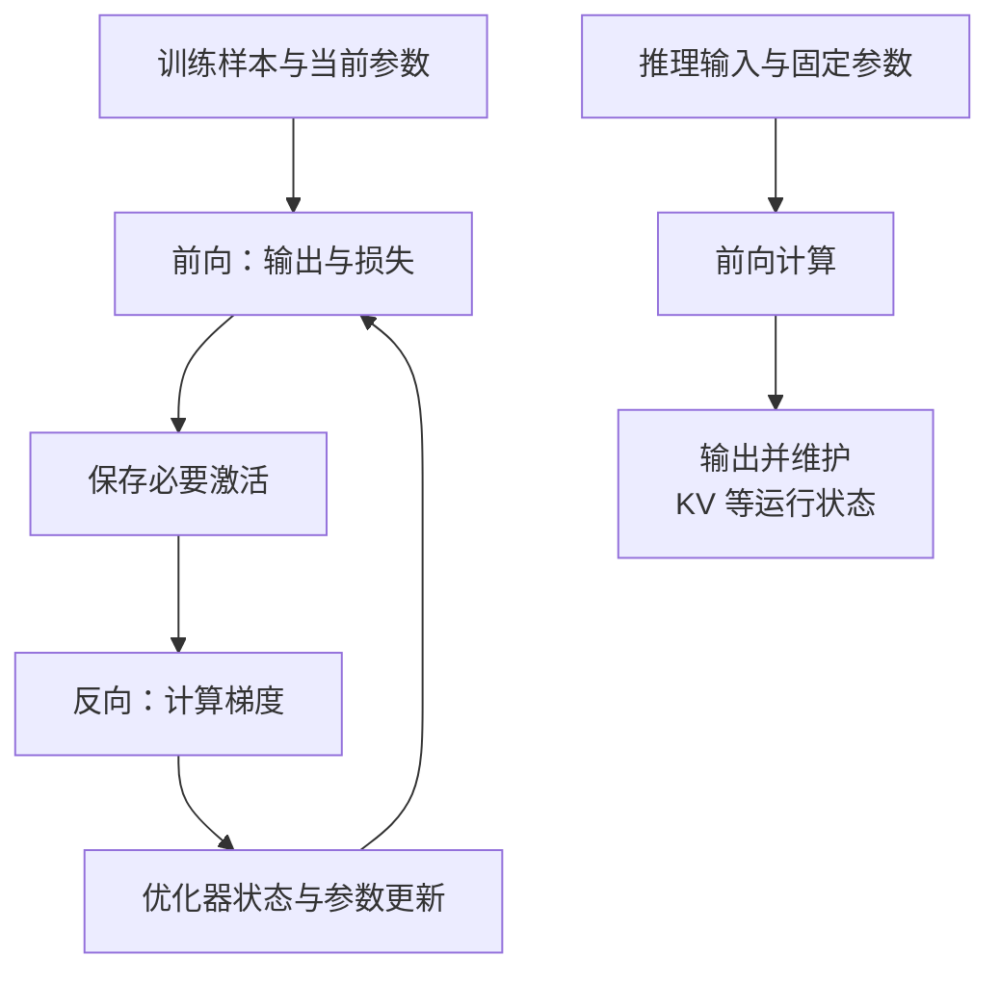

import InterviewQuestion from '../../../../components/InterviewQuestion.astro';

<InterviewQuestion>

预训练用大量数据学习模型参数；微调从已有参数出发，用特定数据继续调整。普通推理用已经训练好的参数计算输出，不执行反向传播和优化器更新。

训练先前向计算输出和损失，再反向计算梯度，最后用优化器更新参数。反向传播需要前向中的中间结果，也就是激活；优化器可能还保存每个参数的动量等状态。这些都占显存。

## 微调也可能很吃资源

全参数微调仍要为参与训练的参数维护梯度和优化器状态。LoRA 冻结基础权重，训练额外的低秩参数，可以减少可训练参数及其状态；基础权重仍要加载，反向所需激活也不会全部消失。

SFT 用示范数据学习期望输出；DPO 使用偏好对调整模型；PPO、GRPO 等后训练方法还涉及在线生成与评分。它们的数据流和组件不同，不能把“微调”都当成同一种训练任务。

### 推理不算梯度，显存就只等于权重吗？

还要加 KV cache、临时张量、算子工作区及框架开销。长上下文、多并发会让 KV 占用增大，权重能放下只是第一步。

### LoRA 一定比全参数微调效果好吗？

不是。它改变的是训练哪些参数，以及相应资源需求。效果要用任务数据评测，结合数据量、任务差异和预算选择。参数量少也不直接代表总训练耗时按比例减少。

资料

核对于 2026-10-13。[阿里云 Pai-Megatron-Patch](https://github.com/alibaba/Pai-Megatron-Patch)、[字节 verl LoRA 后训练](https://verl.readthedocs.io/en/latest/advance/ppo_lora.html)、[LoRA 原始论文](https://arxiv.org/abs/2106.09685)。组件说明为机制概括，不对应特定硬件预算。

</InterviewQuestion>
