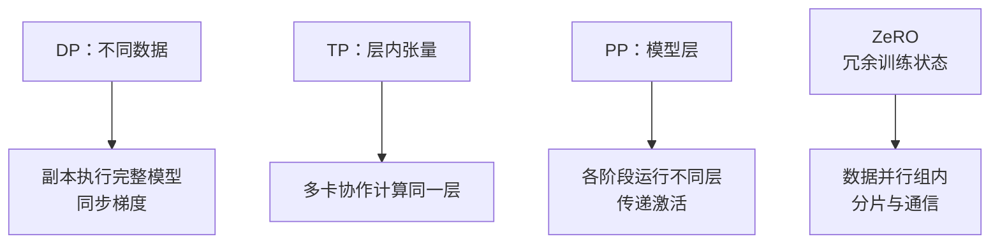

import InterviewQuestion from '../../../../components/InterviewQuestion.astro';

<InterviewQuestion>

朴素 DP 复制完整模型，各卡处理不同样本，再同步梯度。TP 把一层内部的张量计算切到多卡；PP 把不同层分到不同阶段，用 microbatch 跑流水线；ZeRO 在数据并行组内分片训练状态。

单卡 OOM 后直接开 DP，不一定有用：完整模型状态仍在每个副本上。先查是权重、梯度、优化器状态还是激活占得多，再决定怎么切。

## 它们各自省什么，又多了什么开销

| 方法 | 切分对象 | 主要代价 |
| --- | --- | --- |
| 朴素 DP | 样本，模型状态仍重复 | 梯度同步 |
| TP | 层内张量与计算 | 层内通信，依赖互联 |
| PP | 模型层 | 阶段间通信、流水线气泡 |
| ZeRO-1/2/3 | 逐步分片优化器状态、梯度、参数 | 状态收集与通信 |

这些方法可以组合。例如 8 卡采用 `TP=2 × PP=2 × DP=2`，只是一种组合，不代表最优。

传统混合精度 Adam 的一个算例：FP16 权重 2 字节、FP16 梯度 2 字节、FP32 主权重 4 字节、两个 FP32 优化器状态 8 字节，合计 16 字节/参数。7B 参数约 112 GB，还没算激活、工作区和通信缓冲。实际精度、优化器与分片方式不同，数字会变。

### FSDP 和 TP 是一回事吗？

不是。FSDP 分片数据并行下的模型状态，计算前按需收集参数；TP 把层内计算本身分到多卡。两者可以组合。

### 推理也要保存优化器状态吗？

普通前向推理不需要梯度和优化器状态，但要维护 KV 等运行状态。训练的显存估算不能直接套到推理。后训练还要在生成和参数更新之间同步权重、安排设备，verl 这类框架处理的就包括这些工作。

资料

核对于 2026-10-13。国内资料：[PAI 训练参数](https://help.aliyun.com/zh/pai/parameter-settings)、[阿里云官方训练仓库](https://github.com/alibaba/Pai-Megatron-Patch)、[字节发起的 verl](https://github.com/verl-project/verl)。原理：[ZeRO](https://www.deepspeed.ai/tutorials/zero/)、[Megatron 论文](https://arxiv.org/abs/2104.04473)。显存与 8 卡组合均为教学算例。

</InterviewQuestion>
