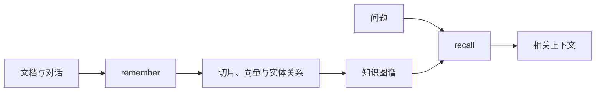

**Cognee 适合把文档、对话和业务资料转成可搜索的知识图谱。它不仅保存文本片段，还会提取实体、关系和摘要，再把它们连接起来。**

如果只需要保存一个用户偏好字段，图结构没有必要。Cognee 更适合“水果—忌口—订单—供应商”这类多实体、多关系的问题。



## v1.0 用 remember 和 recall，不必先拆旧管线

下面按[官方 Quickstart](https://docs.cognee.ai/quickstart) 改写。示例没有在本站运行，需要配置模型服务。

```bash
pip install cognee
export LLM_API_KEY="你的模型服务密钥"
```

```python
import asyncio
import cognee

async def main():
    await cognee.remember(
        "用户喜欢蓝莓。2026-11-03 的订单购买了蓝莓，"
        "没有购买芒果，因为用户说芒果吃了不舒服。"
    )

    results = await cognee.recall(
        query_text="为什么订单没有购买芒果？"
    )

    for result in results:
        print(result.text)

asyncio.run(main())
```

`remember` 会完成摄取、切片、实体关系提取、图谱构建和后续整理。`recall` 根据问题选择检索策略，返回相关上下文。

旧教程中的 `add() → cognify() → memify()` 属于需要拆分管线的用法。官方当前文档建议大多数新应用先用 `remember()`，不要默认照搬旧 API。

## 知识图谱提供关系，不提供事实保证

图谱可以把“用户”“芒果”“订单”和“不舒服”连接起来，帮助回答涉及多个实体的问题。

但实体和关系通常由模型提取。它可能漏掉条件、误解代词或合并同名对象。图里存在一条边，只表示系统提取过这个关系，不代表业务事实已经核验。

订单是否完成、库存是否充足、用户是否允许购买，仍要以业务系统为准。

## 写入成本要在接入前计算

`remember` 不是一个廉价写入操作。切片、向量、实体提取、摘要和图谱整理都可能产生模型或数据库成本。

旧版 Cognify 文档说明，默认提取通常每个片段需要模型调用；额外使用模型写摘要还会增加调用。实际成本取决于文本长度、分块、模型和管线配置。

批量导入前应先用小样本检查：提取质量、重复实体、处理耗时和每次写入成本。不要因为 API 只有一个 `remember`，就把它当成普通数据库插入。

## 更新和冲突需要单独处理

相同内容的增量处理会使用内容 hash 和管线状态减少重复工作。文件更新、替换和追加不是同一操作，不能都靠再次调用相同写入命令解决。

Cognee 的 `improve` 阶段可以执行冲突检查。它帮助发现矛盾，不保证自动决定当前有效事实。用户偏好和订单状态仍需要明确时间与业务规则。

删除还要考虑原文、向量、图谱节点、摘要和缓存。只删除某一个派生结果，不等于整个系统已经遗忘。

## 什么时候选择 Cognee

需要跨文档关系、实体连接和知识图谱可视化时，Cognee 的管线有明确价值。只做个人偏好键值存储时，它过重。

如果数据关系复杂但提取质量不稳定，可以先使用文本检索，再评估图谱是否提高任务成功率。图结构本身不是答案质量的证明。

**Cognee 的核心价值是把资料转成可查询的关系网络。接入前先验证提取质量和写入成本，再决定图谱是否比简单检索更值得。**
