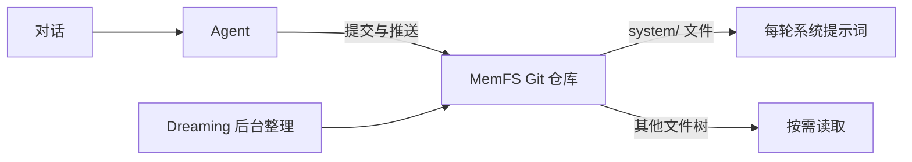

**Letta 当前最值得关注的不是旧版 memory blocks，而是 MemFS：Agent 的长期记忆是一组 Git 管理的文件，Agent 可以读取、修改并提交。**

这适合需要持续学习、可查看历史和跨会话工作的 Agent。代价是写入和后台整理更复杂，不能把“Agent 自己编辑”当成永远正确。



## MemFS 把记忆当成文件系统

创建 Agent 时可以用 `persona` 和 `human` 设置角色与用户偏好，也可以用 `memory` 精确指定初始文件。

```ts
import { LettaAgentClient } from "@letta-ai/letta-agent-sdk";

const client = new LettaAgentClient({
  backend: "cloud",
  apiKey: process.env.LETTA_API_KEY,
});

const agentId = await client.createAgent({
  model: "anthropic/claude-opus-4-8",
  persona: "你是水果采购助手，回答简洁并检查用户忌口。",
  human: "用户喜欢蓝莓，不要推荐芒果。",
  memory: [
    {
      label: "purchase-notes",
      value: "2026-11-03：最后买了蓝莓，没有买芒果。",
    },
  ],
});

console.log(agentId);
```

安装和密钥：

```bash
npm install @letta-ai/letta-agent-sdk
export LETTA_API_KEY="你的密钥"
```

示例依据[官方 Quickstart](https://docs.letta.com/agent-sdk/quickstart/) 与[记忆文档](https://docs.letta.com/agent-sdk/memory/)，没有在本站运行。当前 Agent SDK 只支持 TypeScript；Python 旧教程属于 V1 SDK，不应直接照搬。

## 不是所有文件都会进入每轮上下文

MemFS 中，创建时写入的记忆位于 `system/`。这里的文件会进入每轮系统提示词，因此要保持短小稳定。

其他文件不会全部放进上下文。Agent 看到文件树，需要时再读取。这让长期记忆可以增长，同时避免把全部历史塞进每次请求。

记忆修改需要提交并推送后才算进入持久仓库。MemFS 把 Agent 的记忆放在 Git 仓库中，再投影到当前工作机器；它不是随意散落在某台电脑上的目录。

Git 历史让修改可查看、可恢复，但不会判断哪条事实真实。错误内容仍然可以被提交。

## Dreaming 负责后台整理，不是无条件自动学习

Dreaming 会在指定条件下查看近期对话、整理经验并更新记忆：

```ts
const agentId = await client.createAgent({
  persona: "你是会从采购记录中总结经验的助手。",
  dreaming: {
    trigger: "step-count",
    behavior: "auto-launch",
    stepCount: 25,
  },
});
```

`trigger` 决定何时触发，`behavior` 决定只提醒 Agent，还是自动启动后台子代理。`behavior` 只能在创建 Agent 时设置；Session 可以覆盖触发方式和步数。

后台整理会追加模型与工具成本，也可能总结错误。需要保留原始对话和 Git 历史，才能检查一条记忆是怎样形成的。

## 旧版 memory blocks 与 MemFS 不要混写

V1 SDK 的 memory blocks 是始终显示在上下文里的结构化区域，Agent 可以通过工具修改。MemFS 则把记忆组织成 Git 文件，`system/` 之外的内容按需读取。

旧教程里的 Python `client.agents.create(... memory_blocks=...)` 不能直接代表当前 Agent SDK。选型时先确认使用的是哪套 SDK。

共享记忆仓库可以让多个 Agent 读取同一组文件，但权限、写入冲突和敏感信息传播仍需单独控制。

**Letta 的核心优势是把 Agent 记忆变成可编辑、可提交、可回顾的文件系统。它适合持续工作的 Agent，但必须用 Git 历史、权限和评测约束“自己改记忆”的自由。**
