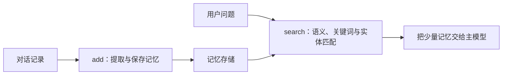

**Mem0 适合在现有 Agent 外面加一层长期记忆：对话结束后提取事实，下次提问时按用户检索。它不是业务数据库，也不能替应用判断哪条偏好现在生效。**

Mem0 的核心动作只有两类：`add` 把对话处理成记忆，`search` 找回相关记忆。真正复杂的是中间的提取、实体关联、排序和用户隔离。



## 最小接入：先搜索，再回答，最后保存

下面按[官方 Python 示例](https://github.com/mem0ai/mem0) 改写。默认配置会使用模型和 embedding 服务，需要相应密钥；示例没有在本站运行。

```bash
pip install mem0ai
export OPENAI_API_KEY="你的密钥"
```

```python
from mem0 import Memory

memory = Memory()
user_id = "alice"

memory.add(
    [{"role": "user", "content": "我喜欢蓝莓，不要推荐芒果。"}],
    user_id=user_id,
)

result = memory.search(
    query="给这位用户推荐什么水果？",
    filters={"user_id": user_id},
    top_k=3,
)

memories = "\n".join(
    f"- {entry['memory']}" for entry in result["results"]
)
print(memories)
```

实际应用中，检索结果应作为参考数据交给主模型，而不是直接当成系统指令。回答完成后，再把本轮对话交给 `add`。

## 新版写入是 ADD-only，不等于自动解决冲突

Mem0 官方新算法说明强调 **ADD-only 提取**：新事实被累积，不在提取阶段执行 UPDATE/DELETE。实体链接和时间检索可以帮助找回相关记录，但这不等于旧偏好会被自动覆盖。

例如用户先说“喜欢蓝莓”，后来说“以后只想买苹果”。两条记录都可能存在。应用需要结合时间、明确表达和当前业务设置判断最新偏好，不能只取分数最高的一条。

如果产品只有一个明确的 `preferred_fruit` 字段，直接更新业务数据库更简单。Mem0 更适合保留分散在对话里的偏好、原因和历史变化。

## 检索不只是向量相似度

当前官方说明把语义、BM25 关键词和实体匹配结合起来：

- 语义搜索处理“蓝莓”和“蓝色浆果”这类表达。
- 关键词搜索保留具体水果名、编号和配置项。
- 实体匹配把同一用户、水果或订单关联起来。
- 时间检索帮助区分当前偏好、过去事件和未来计划。

这些信号提高找到相关记录的概率，不证明记录内容真实，也不保证最新状态一定排在最前。

## 用户隔离必须在调用链中完成

`user_id` 是记忆归属的重要条件。服务端应根据登录身份生成它，而不是让模型或客户端随意传入其他用户 ID。

`search` 和 `add` 都要使用同一套归属规则。只给读取加过滤、写入却混用公共用户，会造成污染和串话。删除、导出和缓存也要按同一用户边界处理。

## 开源、自托管与托管平台不要混为一谈

Mem0 提供本地库、自托管服务和托管平台。官方性能数据来自托管平台的完整模型栈，不能直接当成开源 SDK 的必然结果。

本地库适合验证接入，自托管需要管理模型、向量库、认证和数据保留，托管平台减少运维但会产生外部数据传输。选择时先看隐私和运维约束，再比较功能。

**Mem0 的价值是把“提取—保存—检索”做成现成记忆层。接入时最重要的不是调用 `add`，而是设计用户隔离、当前偏好和错误记录的纠正规则。**
