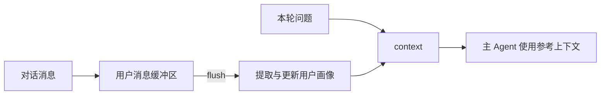

**Memobase 适合围绕用户建立长期画像：先把对话放入缓冲区，再整理成结构化偏好，最后生成当前任务需要的用户上下文。**

它不是简单的聊天搜索库。它的核心问题是“这个用户是谁、长期有什么偏好”，而不是“文档里哪段话和查询最像”。



## 用户、缓冲区和画像是三个关键对象

**User** 对应应用中的一个用户。所有消息、画像和上下文都围绕这个身份组织。

**Buffer（缓冲区）** 暂存尚未整理的消息。写入消息不等于画像已经更新。

**Profile（用户画像）** 保存整理后的长期信息。主题和子主题可以按业务配置，例如水果偏好、预算、忌口和购买习惯。

这种结构让系统可以保存“不要芒果”，而不必每次重新阅读全部聊天。

## 最小 Python 接入

下面按[官方 Quickstart](https://docs.memobase.io/quickstart) 改写。示例没有在本站运行，需要已有 Memobase 后端地址和访问令牌。

```bash
pip install memobase
```

```python
from memobase import ChatBlob, MemoBaseClient

client = MemoBaseClient(
    project_url="http://127.0.0.1:8019",
    api_key="你的访问令牌",
)
assert client.ping()

uid = client.add_user({"name": "Alice"})
user = client.get_user(uid)

blob = ChatBlob(messages=[
    {"role": "user", "content": "我喜欢蓝莓，不要推荐芒果。"},
])
user.insert(blob)

user.flush(sync=True)
print(user.context())
```

`insert` 只把消息放进缓冲区。`flush(sync=True)` 会等待整理完成；默认异步方式适合不希望对话被整理耗时候阻塞的应用。

`context()` 返回可交给 Agent 的个性化上下文。它仍然是从用户内容生成的参考数据，不应被当成不可质疑的系统指令。

## 异步写入带来一个明确的可见性窗口

调用 `insert` 后，画像可能尚未更新。异步 `flush` 也只表示处理已启动，不代表本轮立即可读。

刚写入的偏好可以先放在当前会话上下文里，不必为了等待长期画像而阻塞回复。下一轮读取失败时，也不能用旧画像覆盖用户刚刚明确表达的新要求。

需要确认持久化时，要检查 flush 的处理结果，而不是只看 `insert` 是否成功。

## Profile 的结构要由业务定义

Memobase 允许配置画像主题和子主题。不要一开始就把所有可能的用户属性都加进去。

水果助手只需要少数字段：忌口、偏好、预算和常见购买数量。设备状态、订单状态和库存属于业务数据库，不应被画像里的历史值替代。

如果只有一个明确的忌口字段，业务数据库直接保存更简单。Memobase 更适合从多次对话里积累分散偏好，并在需要时生成用户上下文。

## 用户边界与删除必须一起设计

服务端应根据登录身份选择用户，不允许模型任意读取其他人的 `uid`。消息写入、画像读取、上下文生成和删除都要使用同一身份边界。

画像整理会调用模型，自托管后端不代表内容完全不出机器。使用远端模型时，需要检查发送的数据和供应商的数据保留规则。

**Memobase 的价值是把对话整理成可配置的用户画像。接入时最关键的是明确 `insert` 与 `flush` 的时间差，以及画像不能替代当前业务状态。**
