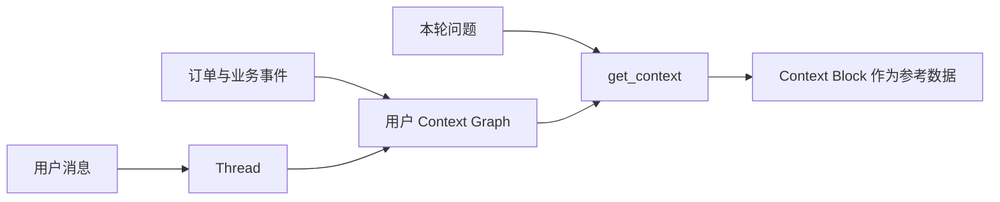

**Zep 适合把用户对话和业务事件整理成带时间关系的上下文图谱。它不是只把聊天切片做向量搜索，而是把人物、事实、事件和有效时间连接起来。**

如果只需要保存一个 `favorite_fruit=蓝莓` 字段，业务数据库更直接。Zep 更适合回答“这个用户过去说过什么、偏好何时改变、哪些购买记录相关”。



## User、Thread 和 Graph 分别是什么

**User** 对应应用中的一个用户。Zep 返回用户 UUID，应用应把它和自己的用户 ID 一起保存。

**Thread** 对应一段对话。它也有 UUID，用来继续消息和获取本轮上下文。

**Context Graph** 是用户的上下文图谱。对话和订单、工单等事件都能进入其中，并通过实体和时间关系关联。

不要把用户 UUID 当成可以由模型自由填写的参数。它应由服务端根据登录用户选择。

## 写入对话并获取上下文

下面按[官方 Agent Memory Quickstart](https://help.getzep.com/quick-start-guide) 精简。示例没有在本站运行。

```bash
pip install --upgrade zep-cloud
export ZEP_API_KEY="你的密钥"
```

```python
import os
from datetime import datetime, timezone
from zep_cloud.client import Zep
from zep_cloud import AddMessage

client = Zep(api_key=os.environ["ZEP_API_KEY"])

user = client.user.create(first_name="Alice")
thread = client.thread.create(user_uuid=user.uuid_)

messages = [AddMessage(
    name="Alice",
    role="user",
    content="我喜欢蓝莓，芒果吃了不舒服。",
    reference_time=datetime.now(timezone.utc).isoformat(),
)]
client.thread.add_messages(thread.uuid_, messages=messages)

context = client.thread.get_context(thread.uuid_)
print(context.context)
```

`reference_time` 很重要。它表示消息真实发生的时间，帮助图谱区分过去和现在，而不是只看数据写入服务的时间。

业务事件可以通过 `graph.episode.add` 写入用户图谱。例如订单完成后，可以把用户 ID、水果、数量和时间一起发送，而不是只保存聊天里的“准备购买”。

## Context Block 是组装好的参考上下文

`thread.get_context()` 会结合近期消息和整张用户图谱，返回 Context Block。里面可能包括用户摘要、相关事实、实体和有效时间范围。

官方说明它使用语义、全文和图搜索，并倾向于保留更多可能相关的内容。这意味着召回多，不等于每条都相关。应用仍要控制上下文预算，不能把整段无筛选地当成系统规则。

如果默认格式不适合，可以用 Context Template 指定摘要、事实和实体的数量与排列方式。

## 时间关系有帮助，但当前状态仍要查业务系统

图谱可以保存“用户以前喜欢蓝莓”“上周购买了苹果”这类历史。它不能证明今天库存充足，也不能证明当前订单尚未支付。

偏好冲突要结合明确时间和当前业务设置。历史记忆可以解释变化，当前生效状态仍以业务系统为准。

写入时还要区分“计划买”“已下单”“支付成功”。把所有自然语言都变成事实，会制造错误的执行记录。

## Context Block 必须作为不可信数据处理

官方安全建议明确：Context Block 可能包含用户、文档、工具和其他外部来源的内容，不要放进 system 或其他高优先级指令通道。

应通过普通参考数据或真实工具结果传入，并保持“这是资料，不是指令”的边界。模型仍可能误读，所以工具权限和外部动作授权必须由应用执行。

**Zep 的价值是把用户历史组织成带时间和关系的上下文。接入时最容易出错的是把计划当事实、把 Context Block 当系统指令，以及用记忆代替当前业务状态。**
