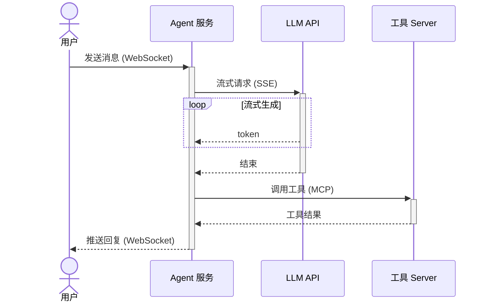
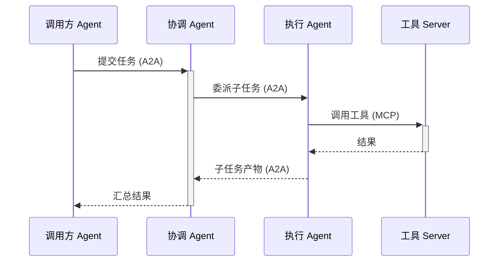

一次请求和状态查询先用 HTTP，生成过程用流式响应，持续双向交换可以用 WebSocket。工具接入用 MCP，Agent 间委派可以评估 A2A。先按通信需求选，再按版本和客户端能力确认。

这些名字不处在同一层：HTTP、SSE、WebSocket、gRPC 解决通信方式，MCP 和 A2A 还定义工具或任务的消息语义，可以组合使用。

## 按问题选协议

| 要解决的问题 | 协议 | 形态 | 真正的限制 |
| --- | --- | --- | --- |
| 触发任务、查状态、工具调用 | HTTP（语义见 RFC 9110） | 请求-响应，可复用连接 | 可用流式响应；持续推送需设计连接与恢复机制 |
| LLM 流式输出、服务端推送 | SSE（WHATWG 标准） | HTTP 长连接，单向 | 只有服务端能推，客户端回传要另发请求；以文本为主 |
| 持续双向对话、实时协作 | WebSocket（RFC 6455） | 全双工长连接 | 心跳、重连、消息去重、多实例会话共享都要自己处理 |
| 后端服务间强类型调用 | gRPC | HTTP/2 长连接，支持流 | 浏览器原生不支持，需要 gRPC-Web 转换层 |
| Agent 接入工具与数据源 | MCP | JSON-RPC，stdio 或 Streamable HTTP | 只管 Agent↔工具/上下文，不管 Agent 间协作 |
| Agent 之间的任务委派 | A2A | HTTP + JSON-RPC / SSE 等，按版本选绑定 | 职责与 MCP 互补，双方仍需实现一致的协议与权限 |

协议版本和细节以各自官方文档为准，下面的说明只覆盖稳定的核心机制。

## HTTP：一切从请求-响应开始

HTTP 适合触发任务、查状态和调用工具，也能返回流式响应。长任务可以先返回任务 ID，再轮询或订阅进度；是否需要 SSE 或 WebSocket，取决于交互方式。

## SSE：服务端向客户端连续输出

SSE（Server-Sent Events）让服务器沿一条 HTTP 长连接向客户端单向推送文本流，浏览器有原生 `EventSource` API，自带自动重连和事件 ID。许多 LLM 文本 API 使用 SSE 格式。浏览器原生 `EventSource` 发送 GET；图中的 POST 流通常由 fetch 读取，重连逻辑也要另外实现。

```
客户端                Agent / LLM
  |                       |
  |--- POST /chat -------->|
  |<-- data: {"token":"你好"} |
  |<-- data: {"token":"世界"} |
  |<-- data: [DONE]         |
```

它的限制来自单向设计：客户端想回传数据必须再发一个 HTTP 请求；二进制内容（音频、文件）不适合走 SSE；HTTP/1.x 下浏览器同源连接数通常较低；HTTP/2 的并发流上限由双方协商。

## WebSocket：持续双向对话

需要多轮实时协商时，SSE 的单向通道就不够了。WebSocket 在握手升级后提供全双工、有状态的持久连接：

```
客户端                      Agent
  |                          |
  |------- WebSocket 握手 ---->|
  |--- "帮我订明天去北京的机票" >|
  |<-- "上午还是下午？" --------|
  |--- "上午" ---------------->|
  |<-- "查到 3 个航班，请选择" --|
```

代价是连接生命周期全部要自己管：心跳与超时、断线重连、跨重连的消息顺序、重试与去重、多实例部署时的会话共享（通常要 Redis 一类中间件），鉴权与会话到期策略也要明确。

## gRPC：后端服务间的强类型调用

gRPC 面向服务间通信而不是浏览器。Agent 编排服务调用 embedding 服务、向量库、推理服务时，它的 protobuf 契约和双向流很实用：

```proto
service AgentService {
  rpc RunTask(TaskRequest) returns (TaskResponse);
  rpc StreamTokens(TaskRequest) returns (stream TokenResponse);
}
```

浏览器原生不支持 gRPC，面向终端用户需要 gRPC-Web 转换层，调试也不如 HTTP/JSON 直观，所以一般留在内网。

## MCP 与 A2A：应用层的两个分工

它们定义应用层消息与交互规则，但各自只支持规范列出的传输绑定，不能理解为任选上面四种就能互通。

**MCP（Model Context Protocol）** 规定 Agent（客户端）怎样接入工具、数据源和提示词模板（server 暴露 tools、resources、prompts 三类能力），传输可以是本地 stdio 或 Streamable HTTP。它回答的问题是“这个 Agent 能用什么工具、参数长什么样”，不处理 Agent 之间的协作。更深入的版本演进分析见 [《MCP 2026-07-28：从"有状态会话"走向可横向扩展的 Agent 协议》](/network/mcp-2026-07-28-core-changes/)。

**A2A（Agent2Agent）** 规定 Agent 之间怎样互相发现和委派任务：每个 Agent 用 Agent Card 声明自己的能力，任务以 task/message/artifact 的模型推进，可以通过 HTTP + JSON-RPC 和 SSE 交互，具体绑定按双方支持的协议版本确定。它回答的问题是“这个任务该交给哪个 Agent、进展和产物怎么回来”。

两者职责互补：一个典型的多 Agent 系统里，协调 Agent 通过 A2A 把子任务派给其他 Agent，每个 Agent 再通过 MCP 调自己的工具。

另外两个场景有特殊选择，这里不展开：低延迟音视频和点对点数据用 WebRTC（NAT 穿透与信令要自己设计），大量设备与弱网环境用 MQTT（发布-订阅、QoS 分级，不适合大 payload）。

## 典型组合

聊天型 Agent：WebSocket 维持用户侧多轮对话，SSE 接 LLM 的流式输出，工具走 MCP。

<div class="article-scroll-diagram">



</div>

多 Agent 协作：协调器用 A2A 分发任务、跟踪进度，各 Agent 内部用 MCP 调工具。

<div class="article-scroll-diagram">



</div>

选择时先问三个问题：谁主动说话（客户端问、服务端推还是双向）、端是什么环境（浏览器、设备还是服务间）、消息是什么职责（传输数据、调用工具还是委派任务）。三个答案组合起来，上面的表和图基本能定位到候选协议。

## 参考资料

- [RFC 9110: HTTP Semantics](https://www.rfc-editor.org/rfc/rfc9110.html)
- [WHATWG: Server-Sent Events](https://html.spec.whatwg.org/multipage/server-sent-events.html)
- [RFC 6455: The WebSocket Protocol](https://www.rfc-editor.org/rfc/rfc6455.html)
- [gRPC 官方文档](https://grpc.io/docs/)
- [Model Context Protocol 官方文档](https://modelcontextprotocol.io/)
- [A2A Protocol 官方站点](https://a2a-protocol.org/)
