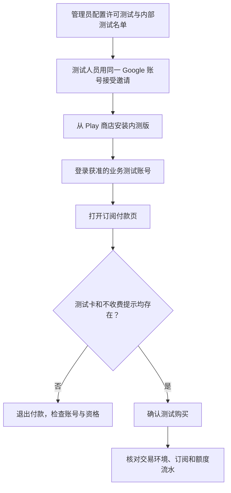

Google Play 内测版不等于免费购买。要完成一次不扣真钱的订阅测试，需要先开通 Google 许可测试资格，再让测试人员接受应用内测邀请、从商店安装，并在付款前确认测试卡和“不收费”提示。如果业务后端限制沙箱账号，还要单独开通业务白名单。

付款成功只是验收的一部分：还需要确认后端识别为沙箱、订阅生效、额度只发一次，以及订阅到期后权益正确结束。下面按实际操作顺序展开；账号、包名和后台名称均使用通用描述，不公开内部配置或用户数据。

## 先分清两个账号、三项资格

| 对象 | 在哪里使用 | 作用 |
| --- | --- | --- |
| Google 账号 | Play 商店、内测邀请页、Play Billing Lab | 下载应用、使用 Google 测试付款方式 |
| 业务账号 | 被测 App | 接收订阅权益和业务额度 |

两个账号的邮箱可以不同。管理员应收集 **Google 邮箱 + 业务注册邮箱或用户 ID**，不需要收集密码、验证码。

| 配置 | 操作人 | 解决什么问题 |
| --- | --- | --- |
| License testing（许可测试） | Play Console 管理员 | 获得测试付款方式 |
| Internal testing（内部测试） | Play Console 管理员 | 通过商店下载未正式发布的应用 |
| 业务沙箱白名单 | 业务管理员 | 允许该业务账号提交沙箱交易并获得测试权益 |

第三项是应用自己的访问控制，不是 Google 的强制配置。如果系统没有这项限制，不应凭空增加配置步骤。使用同一生产后端处理正式与沙箱交易时，建议使用专用业务测试账号，避免测试额度混入日常数据。

:::caution[付款前必须检查]
仅加入内部测试名单，仍可能产生真实扣款。**必须看到测试付款方式及测试购买提示，再确认购买。** 不能靠应用名称带有“测试”、安装来源或价格币种判断。[Google 官方测试说明](https://developer.android.com/google/play/billing/test#license-testers)
:::

## 管理员如何开通

### 1. 加入许可测试名单

1. 登录 Play Console，选择正确的开发者账号。
2. 进入 **Manage account → Play apps settings → License testing**；部分界面仍使用 Settings 导航。
3. 选择 **Email lists**，新建测试名单或编辑现有名单。
4. 在 **Add email addresses** 输入 Google 邮箱，**按 Enter**，确认邮箱出现在已添加列表。
5. 点击 **Save changes**，确认弹窗中的 **Save**。
6. 返回许可测试页，确认该名单已勾选；若修改过勾选状态，再保存页面。

**完成标准：重新打开名单能看到邮箱，且名单已被选为许可测试名单。** 只创建名单、不勾选，不能作为完成依据。

### 2. 加入应用内部测试名单

1. 选择被测应用，进入 **Test and release → Testing → Internal testing → Testers**。
2. 勾选包含该 Google 邮箱的名单并保存。可以复用许可测试使用的名单，但两个页面的选中状态要分别核对。
3. 在 Releases 确认可下载版本已发布，状态为 **Available to internal testers**。
4. 从 **How testers join your test → Join on the web → Copy link** 复制邀请链接，交给测试人员。

没有可下载版本，仅有名单仍不能完成安装。发布和资格变更可能需要传播时间。[Google 内部测试配置](https://support.google.com/googleplay/android-developer/answer/9845334)

### 3. 开通业务沙箱权限（系统有此限制时）

先让测试人员注册业务账号，再在业务后台按注册邮箱或用户 ID 搜索。核对用户身份后启用沙箱权限，重新查询确认保存成功。

**不要直接拿 Google 邮箱代替业务账号。** 搜不到时，先确认是否已注册、是否用了另一个邮箱。

## 测试人员如何安装与购买

### 1. 接受邀请：不能省略

- **核对账号：** 手机 Play 商店账号、邀请网页登录账号，都必须是已登记的 Google 账号。
- **接受邀请：** 打开管理员提供的链接，点击 **Become a tester / 加入测试**。
- **确认成功：** 看到 **You’re a tester**。
- **安装应用：** 点击 **Download test app**，从 Play 商店安装或更新。

**加入名单不等于接受邀请。** 这种邀请链接流程不需要输入邀请码。页面提示无资格时，先检查网页当前账号，再联系管理员。

如果设备上有多个 Google 账号，还要核对实际购买账号。最容易复现的验收路径，是使用专用测试设备或用户空间，并始终使用同一 Google 账号下载安装。

已有调试 APK 且无法安装商店版时，应先让开发人员核对签名冲突，确认数据备份后再决定是否卸载。不要把“清数据、删账号”作为常规排查第一步。

### 2. 登录业务账号并记录余额

打开 App，登录已获准的业务测试账号。首购用例应使用没有有效订阅的账号；已有订阅则应作为换套餐或恢复购买用例。

购买前记录套餐、各类额度和时间。若 App 有订阅额度、免费额度等不同余额，分别记录，不能只记录总额。

### 3. 打开付款页，确认沙箱标识

选择目标订阅后，先停在 Google 付款页，核对：

1. 商品和应用正确。
2. 实际购买账号是许可测试账号。
3. 付款方式为 **Test card, always approves / 测试卡，一律批准**。
4. 页面明确提示是测试订阅、不会收费。

**四项符合后，再点击订阅。** 出现真实银行卡或缺少测试提示，立即退出。显示美元价格本身不代表扣真钱，也不能证明是沙箱。

### 4. 核对后端，不只看成功弹窗

| 验收点 | 应检查的证据 |
| --- | --- |
| 交易环境 | 后端根据 Google 返回的 `testPurchase` 识别测试购买 |
| 订阅 | 对应业务账号的正确套餐已生效 |
| 履约 | 订单履约成功，额度流水能关联该交易 |
| 幂等 | 回前台、重开 App 或重复通知不会重复发同一笔额度 |
| 确认购买 | Google acknowledgement 状态正常，失败有可观察的重试 |
| 到期 | 订阅结束后停止后续发放，按业务规则处理订阅余额 |

Google 的 `testPurchase`、订阅状态和确认状态有明确字段，不能用客户端传入的 `sandbox=true` 代替平台验单。[官方订阅资源定义](https://developers.google.com/android-publisher/api-ref/rest/v3/purchases.subscriptionsv2)

一次脱敏测试中，首购发放了约定的月度额度，已有免费余额保留，重复恢复没有重复发放。后续到期时订阅停止、月度余额归零。**这些结果只能证明该次路径，不能代替升降档、退款等独立用例。**

## 商品不可用时，如何用 Billing Lab 排查

商品为空或购买时提示不可用，先核对账号资格、内测邀请、版本与可售地区。需要测试其他地区时，使用 Google 官方 **Play Billing Lab**：

1. 使用同一个许可测试 Google 账号登录。
2. 在配置设置中选择商品支持的测试地区，保存。
3. 确认信息中心显示目标地区及有效期。
4. 正常购买测试时关闭响应模拟器，不开启真实付款测试。
5. 返回 App 重新查询商品；配置过期后重新应用。

保存失败先重新登录 Lab；不要为了测试永久迁移付款资料或添加真实银行卡。**地区模拟成功，也不能证明购买必然成功。** 一次排查中，地区调整恢复了商品查询，但付款仍失败，后来商店安装版才成功；多项条件改变时，不能把结果归因给唯一因素。[Billing Lab 官方说明](https://developer.android.com/google/play/billing/test#play-billing-lab)

## 沙箱续订时间不能按比例推算

| 正式订阅周期 | Google 沙箱续订间隔 |
| --- | --- |
| 1 周 | 约 5 分钟 |
| 1 个月 | 约 5 分钟 |
| 3 个月 | 约 10 分钟 |
| 6 个月 | 约 15 分钟 |
| 1 年 | **约 30 分钟** |

Google 为不同周期分别规定测试时长，**不是把所有业务时间按“一个月等于五分钟”统一缩短**。因此年付不是 `5 × 12 = 60` 分钟。通常最多自动续订六次，正常月付首购加六次续订约三十五分钟结束；时间可能有偏差，手动加速也会改变节奏。[官方续订时间表](https://developer.android.com/google/play/billing/test#renewal-periods)

平台续订时钟与业务额度发放计划必须区分。年付按月发额度的产品，需要单独验证批次计划；不能看到五分钟过去，就认为后端应再发一笔。应以实际交易、已付周期和业务规则核对。

## 至少覆盖这些用例

| 场景 | 操作 | 验收重点 |
| --- | --- | --- |
| 首购 | 批准测试卡购买 | 正确环境、套餐、一次履约 |
| 取消付款 | 付款页返回，再选同套餐 | 不发额度，仍可继续购买 |
| 拒付 | 使用拒绝测试卡 | 不把失败交易当成功 |
| 重复恢复 | 切后台、重开 App | 同一交易不重复发放 |
| 续订 | 等待测试周期 | 新交易履约，重复通知去重 |
| 取消续订 | Play 订阅页取消 | 已付周期与最终到期分开验收 |
| 宽限期、挂起 | Lab 模拟并核对平台状态 | 权益状态与业务额度规则一致 |
| 升降档、月年切换 | 保留旧订阅进行变更 | 旧购买关联、生效时间、额度差额 |
| 退款或撤销 | 管理员处理指定测试订单 | 区分操作类型，不影响其他交易 |
| 切换业务账号 | 原购买后登录另一账号 | 不重复绑定或重复授予权益 |

宽限期是否发业务额度、升级如何补差，是产品规则；不能把某个项目的选择写成 Google 的通用要求。应在测试前把这些规则转成明确断言。

## 报错时先定位失败阶段

| 现象 | 优先核对 |
| --- | --- |
| 找不到商品 | 账号资格、地区、商品状态、内测安装与实际 Billing 错误码 |
| 网络错误 | 设备到 Google 支付服务的连接；Wi-Fi 已连接不代表支付请求成功 |
| 一直显示正在处理 | 区分业务未付款订单与 Google 的 PENDING 交易 |
| Google 成功但 App 未更新 | 验单、通知、履约、重试和额度流水 |
| 只有真实付款方式 | 停止购买，检查实际 Google 账号和许可测试资格 |

一次实际失败中，手机 Wi-Fi 正常，但 Google 提交购买的连接返回 `ERR_CONNECTION_CLOSED`，Billing 回调为 `NETWORK_ERROR (12)`。它与 `ITEM_UNAVAILABLE (4)` 是不同问题，不能都归为商品配置错误。[Google 错误码说明](https://developer.android.com/google/play/billing/errors)

提交问题时附上版本、安装来源、操作时间及时区、套餐、错误截图、购买前后余额；账号信息只走受控内部渠道，不公开密码、验证码、登录 token 或 purchaseToken。测试完成后，在 Play 订阅页结束不再需要的测试订阅：**卸载 App 不会取消订阅。** [官方取消订阅操作](https://support.google.com/googleplay/answer/7018481)
