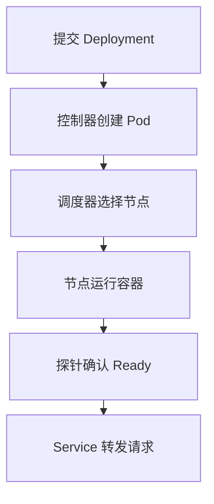

**部署 Kubernetes 应用，先创建 Deployment 管理 Pod，再用 Service 提供稳定入口。** 提交的是期望状态，控制器持续创建、替换 Pod，让实际状态接近期望。`kubectl apply` 成功只代表对象被接受，还要验证副本 Ready、Service 后端和真实请求。

下面使用已有集群里的两副本 Nginx，镜像标签沿用示例基线。操作前确认 `kubectl` 的当前集群和 Namespace；生产镜像另选已验证的版本或 digest。配置、资源限制、探针和回滚也要一起验收。

<div class="article-note-diagram">



</div>

## 集群由什么组成

一个集群由控制平面和工作节点组成。

### 控制平面

| 组件 | 职责 |
|---|---|
| `kube-apiserver` | Kubernetes API 入口，所有对象操作都经过它 |
| `etcd` | 保存集群状态 |
| `kube-scheduler` | 为尚未分配节点的 Pod 选择 Node |
| `kube-controller-manager` | 运行控制器，持续把实际状态拉回期望状态 |

### 工作节点

| 组件 | 职责 |
|---|---|
| `kubelet` | 确保分配到本节点的 Pod 正常运行 |
| 容器运行时 | 拉取镜像并运行容器 |
| `kube-proxy` 或等价实现 | 支撑 Service 网络转发 |

官方架构说明见 [Kubernetes Components](https://kubernetes.io/docs/concepts/overview/components/)。

## 对象模型：spec 和 status

Kubernetes 对象是“期望状态的记录”：

- `spec`：你希望系统变成什么样；
- `status`：系统当前实际上是什么样；
- Controller：持续比较两者并执行修正。

下面的 Deployment 示例包含四个主要部分：

```yaml
apiVersion: apps/v1
kind: Deployment
metadata:
  name: demo-api
spec:
  # 不同 kind 在这里有不同字段
```

不要手写 `status`、`uid`、`resourceVersion`、`managedFields` 等由系统维护的字段。对象模型详见 [Objects in Kubernetes](https://kubernetes.io/docs/concepts/overview/working-with-objects/)。

## 部署一个最小应用

### Namespace

```yaml
apiVersion: v1
kind: Namespace
metadata:
  name: demo
```

Namespace 用来隔离一组资源，不是安全边界的全部。生产环境还需要配合 RBAC、NetworkPolicy 和 ResourceQuota。

### Deployment

```yaml
apiVersion: apps/v1
kind: Deployment
metadata:
  name: demo-api
  namespace: demo
  labels:
    app: demo-api
spec:
  replicas: 2
  selector:
    matchLabels:
      app: demo-api
  template:
    metadata:
      labels:
        app: demo-api
    spec:
      containers:
        - name: api
          image: nginx:1.27-alpine
          ports:
            - name: http
              containerPort: 80
          resources:
            requests:
              cpu: 50m
              memory: 64Mi
            limits:
              cpu: 500m
              memory: 256Mi
          readinessProbe:
            httpGet:
              path: /
              port: http
            initialDelaySeconds: 2
            periodSeconds: 5
          livenessProbe:
            httpGet:
              path: /
              port: http
            initialDelaySeconds: 10
            periodSeconds: 10
```

`selector.matchLabels` 必须和 Pod 模板的 labels 对得上。Deployment 管理 ReplicaSet，ReplicaSet 再维护 Pod 数量。

### Service

Pod 会重建，IP 也会变化。Service 用标签选择一组 Pod，提供稳定的虚拟地址：

```yaml
apiVersion: v1
kind: Service
metadata:
  name: demo-api
  namespace: demo
spec:
  selector:
    app: demo-api
  ports:
    - name: http
      port: 80
      targetPort: http
  type: ClusterIP
```

同一 Namespace 内可以通过 `http://demo-api` 访问；跨 Namespace 可以使用 `demo-api.demo.svc.cluster.local`。

## 配置和 Secret

### ConfigMap

```yaml
apiVersion: v1
kind: ConfigMap
metadata:
  name: demo-api-config
  namespace: demo
data:
  LOG_LEVEL: info
```

### 应用 Secret

```yaml
apiVersion: v1
kind: Secret
metadata:
  name: demo-api-secret
  namespace: demo
type: Opaque
stringData:
  API_TOKEN: replace-me
```

在 Deployment 中引用：

```yaml
envFrom:
  - configMapRef:
      name: demo-api-config
  - secretRef:
      name: demo-api-secret
```

Secret 的 Base64 只是编码，不是加密。不要把生产凭证明文提交到 Git；应使用云厂商 Secret Manager、External Secrets 或密钥加密方案。

## 私有镜像 imagePullSecrets

创建镜像仓库凭证：

```bash
kubectl -n demo create secret docker-registry registry-credentials \
  --docker-server=registry.example.com \
  --docker-username="$REGISTRY_USERNAME" \
  --docker-password="$REGISTRY_PASSWORD"
```

在 Pod 模板中引用：

```yaml
spec:
  imagePullSecrets:
    - name: registry-credentials
  containers:
    - name: api
      image: registry.example.com/team/demo-api:1.0.0
```

凭证 Secret 和使用它的 Pod 必须位于同一个 Namespace。

## 为什么 requests、limits 和探针不能省

| 配置 | 作用 | 注意什么 |
| --- | --- | --- |
| `requests` | 调度器据此分配节点资源 | 按真实用量设置，影响容量规划 |
| `limits` | 限制资源上界 | CPU 可能被节流；内存超限可能 OOMKilled，不是性能目标 |
| `readinessProbe` | 判断能否接 Service 流量 | 失败后不作为就绪后端，不等于重启容器 |
| `livenessProbe` | 判断容器是否需要重启 | 不把下游偶发故障当成本进程失活 |
| `startupProbe` | 给慢启动留初始化时间 | 成功前不让 liveness/readiness 提前介入 |

## 应用和验证

把上述需要使用的对象分别保存到 `k8s/`，确认当前 context 指向演示集群后执行：

```bash
kubectl apply -f k8s/
kubectl -n demo rollout status deployment/demo-api
kubectl -n demo get deployment,pod,service
kubectl -n demo port-forward service/demo-api 8080:80
curl -i http://127.0.0.1:8080/
```

一次完整验证至少包括：

1. Deployment rollout 成功；
2. 期望数量的 Pod Ready；
3. Service 有 Endpoints；
4. 真实请求返回预期结果。

`kubectl apply` 成功只证明 API 接受了对象，不证明应用可用。

## 常用排障路径

### Pod 一直 Pending

```bash
kubectl -n demo describe pod <pod-name>
kubectl get events -A --sort-by=.lastTimestamp
```

先看 `PodScheduled`。未调度时查资源、节点选择器、污点和 PVC；已调度时继续查镜像拉取、挂载和容器启动。

### ImagePullBackOff

```bash
kubectl -n demo describe pod <pod-name>
kubectl -n demo get secret registry-credentials
```

检查镜像名称、tag、Secret 名称、Namespace 和仓库权限。

### CrashLoopBackOff

```bash
kubectl -n demo logs <pod-name> --previous
kubectl -n demo describe pod <pod-name>
```

`--previous` 用来读取上一个已崩溃容器的日志。

### Service 访问不到

```bash
kubectl -n demo get service demo-api
kubectl -n demo get endpointslice -l kubernetes.io/service-name=demo-api
kubectl -n demo get pod -l app=demo-api --show-labels
```

优先确认 Service selector 是否选中了 Ready Pod。

## 生产前检查

- 镜像使用不可变 tag 或 digest；
- 配置与凭证分离；
- requests、limits 和探针齐全；
- 至少配置 PodDisruptionBudget 或明确可接受的中断策略；
- 使用滚动发布并验证回滚；
- 权限遵循最小化原则；
- 日志、指标和事件可以被采集；
- 数据卷、备份和恢复方案经过验证；
- 不依赖手工修改线上对象；
- manifest 能通过 CI 校验和测试。

遇到 Pending、崩溃或请求失败，继续看 [Kubernetes 生产排障](/ops/k8s/kubernetes-production-troubleshooting/)。
