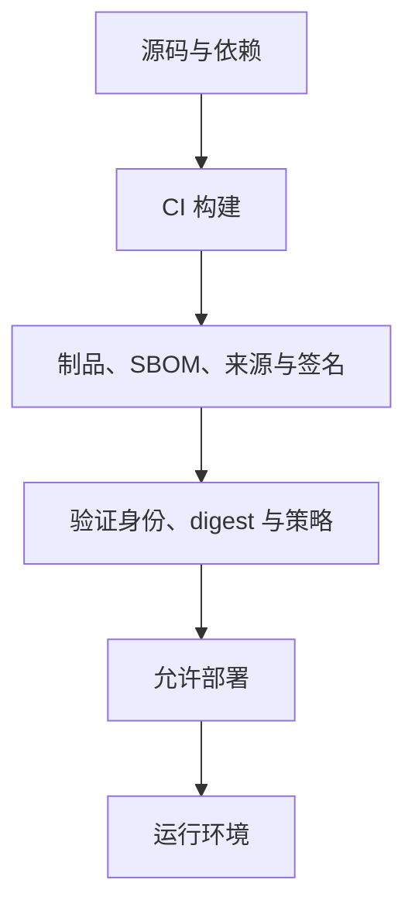

发布一个制品前，要确认它包含什么、来自哪次构建、为什么允许进入环境。SBOM 记录组件，Provenance 记录构建来源，签名与门禁验证身份、内容和发布策略。它们互相补充，不能单独证明软件没有漏洞。

例如镜像 tag 被覆盖：漏洞扫描即使通过，也不能证明部署的是批准的版本。用 digest 固定制品，再验证它的来源和签名，才能把检查结果与实际部署对象对应起来。

链路上任何一段都可能被替换：恶意依赖或被接管的包、未固定版本的构建工具、CI 凭证泄漏、构建脚本下载未校验的文件、仓库里的 tag 被覆盖、部署绕过正式流水线。

## 四种机制各管一段

| 机制 | 回答的问题 | 关键内容 | 不能证明的事 |
| --- | --- | --- | --- |
| SBOM | 制品里有什么 | 组件名称与版本、包管理器或 PURL、直接与间接依赖、组件哈希、许可证、生成工具与时间、对应制品身份 | 不是安全结论，要和漏洞数据、可达性、资产暴露、VEX 一起用 |
| Provenance | 制品从哪里来 | 源码仓库与不可变 revision、构建工作流身份、构建平台、输入参数和依赖、输出制品 digest、生成时间 | 项目脚本自己声明的不可信，应由构建平台生成 |
| 签名 | 谁签的、内容有没有被改 | 制品 digest 未变化、签名身份属于允许的组织、签名来自允许的仓库与工作流 | 证明身份与内容完整性，不证明软件没有漏洞 |
| 发布门禁 | 为什么允许它运行 | 上面三者的验证结果 + 漏洞处置策略 | 只在制品进入环境之前有效，事故后查日志不算门禁 |

SBOM 生成后要和制品一起保存。只在开发机导出一份 JSON、没有绑定具体镜像 digest，后续很难证明它描述的是哪个版本。

验证签名时不要只检查“存在一个有效签名”：任何拿到其他有效身份的人都可能签出不符合本项目策略的制品。部署端至少验证制品 digest 未变化、签名身份属于允许的组织、签名来自允许的仓库与工作流、Provenance 指向批准的源码 revision、构建过程满足最低策略、SBOM 已生成并通过风险门禁。

这些机制各自独立取值，按风险选组合即可，不是 CVE 扫描、SBOM、SLSA 逐级攀登的必选成熟度台阶。SLSA 等级描述的是构建完整性的保障强度，不是强制路线。

## 漏洞扫描之后还要判断可达性

一个依赖命中 CVE，不等于应用一定可利用。排序时继续结合：受影响版本范围、代码路径是否可达、运行时是否启用相关功能、资产是否暴露、EPSS 与 KEV（CISA 已知被利用漏洞目录）、是否存在补丁或可行缓解、VEX 对“受影响 / 不受影响”的机器可读声明。“扫描为零”也不代表没有供应链风险——未知漏洞和构建系统被篡改不会自动出现在 CVE 列表里。

## 依赖进入仓库之前

- 启用 Lockfile 并在 CI 使用冻结安装；
- 限制新依赖的审批人；
- 检查包名相似攻击和维护者变化；
- 优先依赖活跃、来源明确的项目；
- 私有仓库防止 Dependency Confusion；
- Renovate、Dependabot 等更新 PR 必须经过测试；
- 安装脚本和生命周期脚本按需禁用或隔离。

## CI/CD 最小权限

- PR 构建默认拿不到生产凭证；
- Fork 贡献不能直接运行高权限工作流；
- 使用短期身份代替长期云密钥；
- 构建与发布拆分权限；
- Runner 隔离，不复用被不可信代码污染的工作区；
- Release tag、环境和审批规则受保护；
- 日志自动脱敏。

## 发布门禁的最小策略

1. 制品使用 digest 引用；
2. SBOM 与 Provenance 存在；
3. 签名身份和源码仓库匹配；
4. Critical 漏洞必须有修复、缓解或批准的例外；
5. 已进入 KEV 且资产暴露的漏洞禁止发布；
6. 例外必须包含负责人、理由和过期时间；
7. 部署系统拒绝未经过正式流水线的制品。

延伸阅读：

- [SLSA v1.2 Specification](https://slsa.dev/spec/v1.2/)
- [SLSA：Provenance](https://slsa.dev/spec/v1.2/provenance)
- [OpenSSF（开源安全基金会）](https://openssf.org/)
