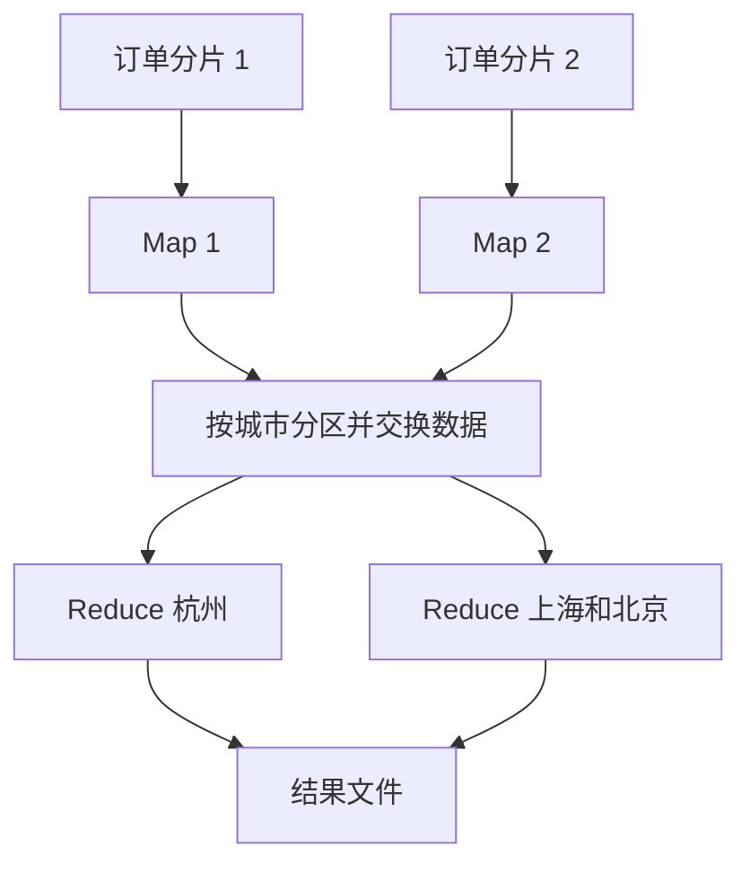

# MapReduce：按键组织分布式批处理

> **本站补充**：原仓库将本主题列为待完善。本节的说明、示例和取舍由本站整理，不属于原仓库译文。

MapReduce 把大规模计算拆成两类工作：Map 从输入记录产生键值对，Reduce 汇总同一个键对应的值。连接两者的是 Shuffle：把散落在不同机器上的同键数据送到同一个归并任务。并行计算能否获益，往往取决于中间数据量和键是否均匀，而不只是机器数量。

它适合对大批数据做计数、分组汇总和离线索引。一次作业包含调度、数据交换和结果落盘，不能只凭“能并行”就把它用于低延迟在线请求。Google 的原始论文同时定义了计算模型和运行时职责，包括分区、调度、失败恢复与通信。[MapReduce 论文](https://research.google/pubs/mapreduce-simplified-data-processing-on-large-clusters/)

## 例子：统计各城市的销售额

假设要统计一天的订单销售额，金额用整数“分”表示。下面只有六条记录，目的是看清数据流；实际输入可以是很多文件。

| 输入分片 | 城市与金额 |
| --- | --- |
| 分片 1 | 杭州 1200、上海 800、杭州 300 |
| 分片 2 | 上海 700、北京 600、杭州 500 |

Map 将每条订单转换成 `(城市, 金额)`。即使两个杭州订单来自不同机器，它们最终也必须参加同一次杭州汇总。



图中把杭州分给一个 Reduce，把上海、北京分给另一个，只是为了说明分区。一个 Reduce 通常会处理多个键，并非每个键独占一个进程。

| Reduce 看到的键 | 汇集的金额 | 输出 |
| --- | --- | --- |
| 杭州 | 1200、300、500 | 2000 分 |
| 上海 | 800、700 | 1500 分 |
| 北京 | 600 | 600 分 |

## 四个阶段各自负责什么

1. **切分与读取**：把输入划成可独立处理的记录集合。输入格式需要处理记录边界；文件字节块不能随便当成完整业务记录。
2. **Map 与可选的局部合并**：各任务产生中间键值对；能够安全局部汇总时，用 Combiner 减少后续传输。
3. **分区、Shuffle 与排序分组**：Partitioner 决定哪个 Reduce 接收某个键。所有参与者必须使用相同规则，使相等的键落入同一分区。框架搬运各 Map 的相关分区，再按键分组；这不等于全局结果已经排好序。
4. **Reduce 与提交结果**：每组执行汇总，通常生成多个结果文件。应用应消费一次成功作业的完整输出，而非把半写入目录当成最终结果。

Hadoop 的实现会在交换数据时合并排序结果，并在内存不足时落盘。Shuffle 是实际的数据交换阶段，不是“随机打乱记录”。[Hadoop MapReduce 教程](https://hadoop.apache.org/docs/current/hadoop-mapreduce-client/hadoop-mapreduce-client-core/MapReduceTutorial.html)

## 一个可运行的缩小模型

以下 Python 3 代码演示 Map、局部合并和按键汇总。它在一台机器的内存中运行，没有实现网络、外部排序、任务调度或容错。

```python
from collections import defaultdict


def map_reduce_sales(splits):
    grouped = defaultdict(list)
    for records in splits:
        # Map 后按键做局部合并。
        partial = defaultdict(int)
        for city, amount_cents in records:
            partial[city] += amount_cents
        # 模拟 Shuffle：相同城市进入同一组。
        for city, subtotal in partial.items():
            grouped[city].append(subtotal)
    return {city: sum(values) for city, values in grouped.items()}


splits = [
    [("杭州", 1200), ("上海", 800), ("杭州", 300)],
    [("上海", 700), ("北京", 600), ("杭州", 500)],
]
assert map_reduce_sales(splits) == {"杭州": 2000, "上海": 1500, "北京": 600}
assert map_reduce_sales([]) == {}
```

这里传给最终汇总的是五个局部小计，原始记录有六条。真实收益取决于一个 Map 内有多少重复键；如果每条记录的键都不同，Combiner 几乎不能减少数据。

### 为什么平均值不能直接这样合并

分片 1 有 `10、20`，平均值为 15；分片 2 只有 `90`，平均值为 90。把局部平均值再平均得到 52.5，但正确结果是 40。

应该传递可合并的状态 `(sum, count)`：先得到 `(30, 2)` 和 `(90, 1)`，合并成 `(120, 3)`，最后相除。求和、计数可以直接合并；中位数不能仅靠“各分片中位数”精确恢复。

Combiner 是可选优化，正确性不能依赖它一定执行或只执行一次。合并操作应满足相应的结合性要求；如果执行顺序不固定，还要保证顺序变化不会改变结果。

## 失败、慢任务与重复执行

一个工作节点失效后，框架可以重新调度其任务；慢任务也可能触发备份执行。因而业务函数应尽量确定、可重算，不要把“执行一次 Map”直接等同于“外部扣款一次”。输出文件的提交机制与外部系统的副作用是不同问题。[原论文：执行模型与容错](https://storage.googleapis.com/gweb-research2023-media/pubtools/4449.pdf)

在订单示例中，需要分别解决两个重复来源：输入本身重复，应按订单标识去重或明确统计口径；同一任务的重试，应由作业提交机制选定有效输出。仅在函数里累加一个远端计数器，可能把重试也计入金额。

## 最容易遇到的瓶颈与取舍

| 情况 | 原因 | 可选处理与代价 |
| --- | --- | --- |
| Map 很快，作业仍很慢 | 中间结果过大，网络或磁盘成为瓶颈 | 提前过滤、局部合并、压缩；压缩消耗 CPU，过滤必须保持统计语义 |
| 一个 Reduce 特别慢 | 热点键把大量数据集中到一个任务 | 对可合并汇总先加盐拆成多个子键，再做第二次汇总；增加一个阶段 |
| Reduce 内存溢出 | 把某个键的所有值一次性装入内存 | 尽量流式归并；有些计算仍需要外部排序或改变算法 |
| 迭代算法反复读写 | 多轮作业不断交换和落盘 | 考虑能复用中间状态的执行方式；同时评估内存容量和恢复成本 |
| 少量数据也启动集群 | 调度成本大于计算本身 | 先看单机或数据库聚合能否满足需求，不以节点数作为目标 |

选择 MapReduce 前，应估算输入大小、中间结果放大倍数、最热键的数据量、截止时间和重跑成本。一个查询能被拆成 Map 与 Reduce，并不意味着分布式执行一定更快。

延伸阅读：[原论文](https://storage.googleapis.com/gweb-research2023-media/pubtools/4449.pdf)、[Hadoop 教程](https://hadoop.apache.org/docs/current/hadoop-mapreduce-client/hadoop-mapreduce-client-core/MapReduceTutorial.html)。相关站内章节：[数据库分片](/system-design/database/#分片)、[Scatter-gather](/system-design/work-in-progress/scatter-gather/)。
