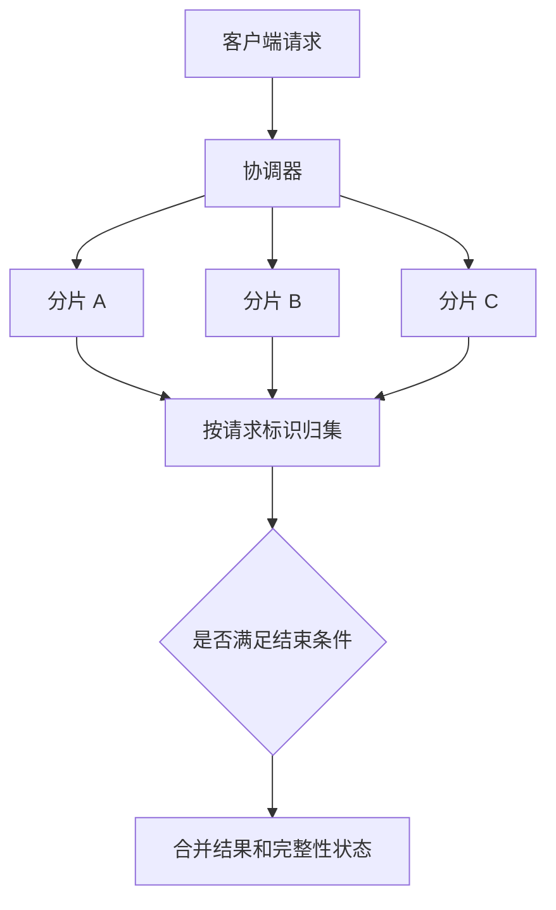

# Scatter-gather：并行请求，再按规则汇总

> **本站补充**：原仓库将本主题列为待完善。本节的说明、示例和取舍由本站整理，不属于原仓库译文。

Scatter-gather 把一个请求分发给多个参与者，再把回复合并成一个结果。难点不只在并行发送，而在于事先定义：请求发给谁，等到什么时候，缺少回复时能否返回，以及怎样避免把部分结果当成完整答案。

它可以用于分片搜索、多供应商报价和跨服务聚合。这里讨论的是服务或消息层的分发与汇总，不是设备 I/O 中的 scatter/gather，也不是 DMA 控制器。[Enterprise Integration Patterns 的定义](https://www.enterpriseintegrationpatterns.com/patterns/messaging/BroadcastAggregate.html)

## 例子：从三个搜索分片取前两名

假设文档分布在三个不重叠的分片中，分数可跨分片比较，并使用统一的排序规则。客户端要求全局前两名，协调器让每个分片返回自己的前两名。

以下时间和分数均为演示数据。分片耗时从统一发出请求的时刻开始计算。

| 分片 | 返回时间 | 本地前两名：文档与分数 |
| --- | --- | --- |
| A | 45 ms | A1: 90，A2: 70 |
| B | 70 ms | B1: 85，B2: 60 |
| C | 160 ms | C1: 99，C2: 80 |

全部结果到齐后，全局前两名是 **C1、A1**。如果只等到 80 ms，收到 A、B 的结果就结束，得到的是 **A1、B1**。它们只是已响应分片中的前两名，不能标成全局精确前两名。



为什么每个分片只返回本地前 K 名就够了？在上述不重叠、统一排序、无额外全局过滤的条件下，一个文档若不是本分片的前 K 名，就已有至少 K 个文档排在它前面，因此它不可能进入全局前 K 名。若分数不可比较、还要全局去重或执行额外过滤，这个结论不能直接套用。

## 先确定结束条件

Aggregator 需要识别哪些回复属于同一批请求，并根据完成条件决定何时汇总。[Aggregator 模式](https://www.enterpriseintegrationpatterns.com/patterns/messaging/Aggregator.html)

| 策略 | 适用情形 | 必须说明的限制 |
| --- | --- | --- |
| 等待全部成功 | 精确总量、完整搜索覆盖 | 一个分片失败就不能声称得到完整结果；仍需总截止时间 |
| 截止时间内返回部分 | 可接受降级的展示类查询 | 返回覆盖范围和缺失分片；结果可能偏向响应快的分片 |
| 首个满足条件的结果 | 多个等价副本竞速，或任一有效答案足够 | 分片数据互补时不适用；额外请求会增加负载 |
| 达到预定数量 | 业务明确定义了样本或副本要求 | 收到多数分片不等于读到了全部数据，也不会自动得到一致性保证 |

在搜索例子中，可以定义端到端预算为 120 ms，其中最多用 80 ms 收集分片结果，为合并、序列化和返回留出余量。这是一组示例预算，不是通用性能指标。排队、重试也必须消耗同一个预算，不能给每次重试重新发放完整超时时间。

## 把缺失信息放进返回结果

允许部分结果时，响应至少需要携带完整性与覆盖范围。示例中的逻辑结果可表示为：

```json
{
  "request_id": "search-42",
  "complete": false,
  "responded_shards": ["A", "B"],
  "missing_shards": ["C"],
  "failed_shards": [],
  "items": [["A1", 90], ["B1", 85]]
}
```

`request_id` 用于关联一次逻辑请求，`shard_id` 用于识别分片；重试还可携带独立的 attempt 标识。协调器应规定哪个终态有效，并去掉重复回复。迟到的 C 不能写进另一个请求，也不能在响应发出后悄悄改变已返回的结果。

## 用离线模型检查汇总规则

下面的 Python 3 代码把“分片、回复时间、候选结果”作为输入。`None` 表示明确失败；超过截止时间的回复不参与本轮结果。同一分片按到达时间接受第一个终态，忽略后续重复回复。输入候选记录假定互不重复，分数和 ID 均可比较。

这个模型把失败也视为终态。如果允许重试恢复，可以先在子请求层完成重试，再上报最终结果；或者给汇总器定义接受后续成功的状态规则。

这段代码只验证汇总语义，不发送网络请求，也不实现真实的计时、取消或重试。

```python
def gather(responses, expected, deadline_ms, k, require_all=True):
    expected = set(expected)
    if not expected or k < 1 or deadline_ms < 0:
        raise ValueError("invalid gathering contract")
    seen, failed, successful = set(), set(), {}
    for shard, elapsed_ms, items in sorted(responses, key=lambda row: row[1]):
        if elapsed_ms > deadline_ms or shard not in expected or shard in seen:
            continue
        seen.add(shard)
        if items is None:
            failed.add(shard)
        else:
            successful[shard] = items
    complete = set(successful) == expected
    if require_all and not complete:
        raise RuntimeError("incomplete shard coverage")
    candidates = [item for items in successful.values() for item in items]
    top = sorted(candidates, key=lambda item: (-item[1], item[0]))[:k]
    return {
        "complete": complete,
        "responded_shards": sorted(successful),
        "missing_shards": sorted(expected - seen),
        "failed_shards": sorted(failed),
        "items": top,
    }


responses = [
    ("A", 45, [("A1", 90), ("A2", 70)]),
    ("B", 70, [("B1", 85), ("B2", 60)]),
    ("C", 160, [("C1", 99), ("C2", 80)]),
]
partial = gather(responses, ["A", "B", "C"], 80, 2, require_all=False)
assert partial["items"] == [("A1", 90), ("B1", 85)]
assert partial["missing_shards"] == ["C"]
assert partial["complete"] is False
full = gather(responses, ["A", "B", "C"], 200, 2)
assert full["items"] == [("C1", 99), ("A1", 90)]
```

真实系统还需要：在截止时间到达时停止等待，向下游传播取消信号，释放连接与汇总状态，并记录迟到回复。取消请求不代表对端一定停止执行，因此对有副作用的操作仍需幂等设计。汇总器也应限制每个分片的返回大小，不能无界积累候选结果。

## 为什么扇出越大，尾延迟越突出

若必须等待全部分片，并且请求近似同时开始，整体等待时间接近最慢子请求的耗时，再加上调度与合并开销。增加分片可以减少每个分片的工作量，也增加了碰到慢节点的机会。Google 的 *The Tail at Scale* 讨论了规模扩大后尾延迟对交互式服务的影响。[论文](https://research.google/pubs/the-tail-at-scale/)

假设每个子请求独立地有 1% 概率超过某个阈值，扇出到 100 个节点时，至少一个超标的概率为：

```text
1 - 0.99^100 ≈ 63.4%
```

这是概率模型，不是线上测量；共享网络、存储或限流造成的相关性会改变结果。副本竞速可能降低等待时间，却会增加负载，不能无条件地向所有副本重复发送所有请求。

## 成本与选择

- **请求放大**：每秒 1,000 个外部请求，扇出 20 路，就有约 20,000 个子请求；重试与副本竞速还会继续增加。需要限制并发和重试预算。
- **协调器成本**：R 个分片各返回 K 个候选，直接排序要处理最多 R×K 项。可以用有界堆等方式降低合并成本，但结果大小、连接数和状态数量仍要设上限。
- **正确性成本**：缺失分片、重复回复、版本不一致都必须进入契约。精确金额或全量计数不能把超时分片当成零。
- **替代方案**：如果可预计算，就不一定需要每次在线扇出；如果能根据键路由到单个分片，也不必广播查询。

Scatter-gather 描述请求与响应的组织方式。[MapReduce](/system-design/work-in-progress/mapreduce/) 还规定了按键分组的计算模型和作业执行过程；两者不能仅因都包含并行与汇总就互换。对于节点与键的归属，可以继续阅读[一致性哈希](/system-design/work-in-progress/consistent-hashing/)。
